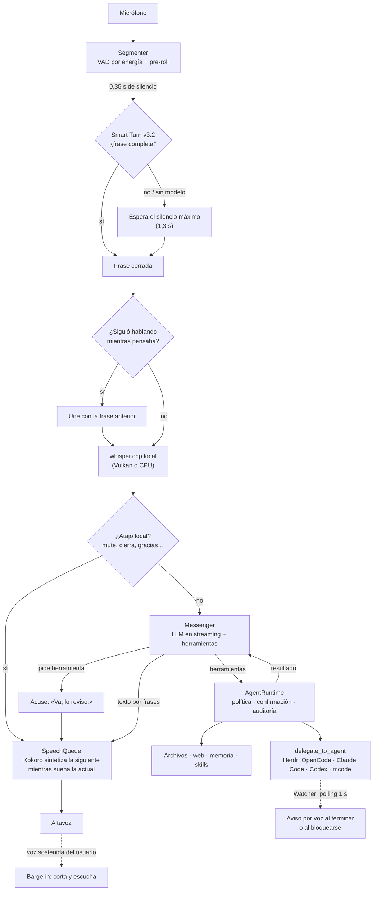

# Arquitectura de EzAgent

EzAgent es una capa de voz local para agentes de código. Este documento sigue
un turno de conversación de punta a punta y explica qué módulo hace cada parte,
en qué hilo corre y dónde guarda su estado.

## Vista general



| Etapa | Módulo | Dónde corre |
|---|---|---|
| Captura y VAD | `voice/audio.py` (`MicCapture`, `Segmenter`, `BargeInDetector`) | Hilo de audio |
| Fin de turno | `voice/turn.py` (`SmartTurn`, ONNX) | Hilo propio (`ezagent-turn`) |
| Transcripción | `voice/stt.py` → `whisper-server` local | Hilo por turno |
| Atajos locales | `VoiceApp._fast_command` en `voice/app.py` | Hilo principal |
| LLM y herramientas | `voice/llm.py` (`Messenger`) + `agent/runtime.py` | Hilo de respuesta |
| Clientes LLM | SDK de OpenAI o `voice/anthropic_client.py` | Hilo de respuesta |
| Voz | `voice/speech_queue.py` + `voice/tts.py` (Kokoro ONNX) | Hilo de respuesta (síntesis) y `ezagent-speech` (reproducción) |
| Agentes delegados | `voice/herdr.py`, `agent_driver.py`, `agent_session.py` | Hilo de respuesta |
| Avisos | `voice/watcher.py`, `voice/tasks.py` | Hilo del watcher |
| Interfaz | `voice/notch/` (barra y tarjeta de ajustes, Win32 layered) | Hilo de la barra |

## Un turno, paso a paso

### 1. Escuchar y decidir cuándo terminaste

`MicCapture.stream` lee bloques de 30 ms a la frecuencia nativa del micrófono y
se los pasa al `Segmenter`:

- **Arranque:** tres bloques seguidos por encima del umbral, con suelo de ruido
  adaptativo. Se conservan 0,6 s de pre-roll para no perder la primera sílaba.
- **Fin de turno:** con histéresis, solo cuenta como silencio lo que baja del
  umbral de cierre. Tras `turn_quick_secs` (0,35 s) de silencio, el segmentador
  pide a **Smart Turn** si la frase está completa. La inferencia (50–90 ms)
  corre en el hilo `ezagent-turn` y el hilo de audio no se bloquea: mira el
  resultado en los bloques siguientes.
  - Completa: el turno se cierra ya (`VAD end: … (fin de turno detectado)`).
  - Incompleta, o sin modelo: se espera `silence_secs` (1,3 s), como antes.
- Smart Turn usa los últimos 8 s a 16 kHz, rellenados con ceros **al principio**,
  y las características log-mel de Whisper calculadas con numpy (verificadas
  contra `WhisperFeatureExtractor`).

**Unión de frases.** Si el turno se cerró en una pausa y vuelves a hablar en
los 3 s siguientes, mientras EzAgent aún piensa, la respuesta pendiente se
descarta y la frase nueva se transcribe **junto con la anterior**
(`Sigues hablando: uno esta frase con la anterior`).

**Barge-in.** Mientras EzAgent habla, `BargeInDetector` solo interrumpe si tu
voz supera `barge_in_rms` durante `barge_in_secs` seguidos. Es independiente
del fin de turno: bajar la espera de silencio no hace la interrupción más
sensible. Los arranques de voz durante el TTS se tratan como eco y se
descartan.

### 2. Transcribir

`whisper-server` (whisper.cpp) corre en un puerto local libre. Lo arranca la
app, que lo precalienta y elige Vulkan o CPU según `stt_engine`. La frase viaja
como WAV por HTTP local y tarda 150–250 ms con `large-v3-turbo`.

### 3. Atajos locales

Antes del LLM, `_fast_command` resuelve órdenes de control sin red: silenciar o
reactivar el micrófono, cerrar la escucha, colgar, repetir, saludar, listar
agentes o tareas y agradecer («Gracias» → «De nada»). Primero quita las
cortesías iniciales, así «Ok, gracias. Mutéate» silencia igual que
«mutéate».

### 4. Pensar: `Messenger` y el núcleo agéntico

`Messenger.ask_stream` arma la petición y la envía en streaming. En cada turno:

1. `AgentRuntime.begin_turn` recarga permisos, skills y herramientas.
2. **System prompt**, con el orden pensado para la caché por prefijo del
   proveedor:
   preámbulo de seguridad (inmutable) → `system.md` → guía de acuse →
   memoria y tareas pendientes → catálogo de agentes → catálogo de skills →
   **momento actual** (la hora, al final, porque cambia cada minuto).
3. **Herramientas:** hasta 14, elegidas según el texto (`select_tool_names`).
4. **Bucle de hasta 4 rondas:** si el modelo pide herramientas, el runtime las
   ejecuta con política, confirmación y auditoría, y el resultado vuelve al
   modelo como mensaje `tool`.

**Acuse inmediato.** Si el modelo va a usar una herramienta, el prompt le pide
empezar con una frase corta («Va, lo reviso.»). Si no lo hace, el código dice
una de `ACK_FILLERS` en cuanto llega la primera llamada a herramienta. Así no
queda silencio mientras trabaja. No se usa con `voice_control`, que es
instantáneo.

**Clientes.** Según `llm_api_style`:

- `openai`: SDK de OpenAI (Chat Completions), sin reintentos automáticos.
- `anthropic`: `AnthropicChatClient`, que traduce a la API Messages (system,
  `tool_use`, `tool_result`, SSE) y devuelve trozos con la misma forma que el
  SDK de OpenAI, así el bucle de herramientas no cambia.

**Errores.** `friendly_llm_error` convierte 401/403, 404, 413, 429 y los fallos
de conexión en una frase que se dice por voz. El detalle técnico queda en el
log.

### 5. Hablar: `SpeechQueue`

`_answer_worker` consume el streaming y lo corta en frases (`_Sentences`); el
primer trozo es una cláusula corta para que el primer audio llegue antes. Cada
frase se sintetiza con Kokoro en el hilo de respuesta y se encola; el hilo
`ezagent-speech` la reproduce. Mientras suena la frase N, ya se sintetiza la
N+1, así no quedan huecos entre frases. Kokoro tiene un lock de síntesis y la
reproducción otro, porque no admite dos síntesis a la vez.

### 6. Medir

`TurnTimings` (`voice/metrics.py`, con lock porque lo escriben varios hilos)
registra cada turno:

```
Tiempos: VAD 390 ms | STT 157 ms | LLM 2297 ms (1.er token 2140 ms) |
TTS 781 ms síntesis | Voz 2656 ms | 1.er audio a los 3375 ms | Turno 6062 ms
LLM por llamada: llamada 1: 2531 ms al 1.er fragmento, delegate_to_agent 1515 ms |
llamada 2: 1235 ms al 1.er fragmento
```

Cada diez turnos se añaden la media y el P95 por etapa, y todo queda en
`%APPDATA%\EzAgent\logs\latency.jsonl`.

## Agentes delegados

`delegate_to_agent` (`agent/tools_herdr.py`) es la única puerta hacia los CLIs
de agentes:

- **run:** `agent_driver` arma el comando desde el perfil de `voice.json`
  (`agents`, `agent_profiles`), con modelo y esfuerzo validados.
  `agent_session` abre una pestaña visible de Herdr, espera a que el programa
  arranque, fija modelo y esfuerzo con sus comandos internos y pega la tarea.
  Para tareas de interfaz gráfica (`gui=true`) antepone la guía de cua-driver.
- **send:** envía la tarea a un agente ya abierto **tal cual**, sin preámbulo.
- **read / get / list / focus / watch / kill:** leer la pantalla, consultar,
  enfocar, vigilar o cerrar.
- **Cadenas** (`input_from`, `then`): cuando un agente termina, su salida pasa
  al siguiente como dato. `handoff` extrae solo la respuesta de la pantalla y
  `handoff_packet` decide si pasa la respuesta corta, la conclusión, o un
  índice más el archivo con el registro completo.

**Avisos.** `Watcher` consulta `hc ls --json` cada segundo. Cuando un agente
vigilado termina o se bloquea, la app avisa por voz con la tarea concreta,
guardada en `tasks.json`. La salida del agente se trata siempre como dato no
confiable.

## Seguridad

- Sin shell libre: solo se lanzan los CLIs declarados en `voice.json`, con
  argumentos como lista.
- `agent/policy.py` es la única puerta para permitir, confirmar o denegar. Las
  operaciones destructivas siempre se confirman y borrar manda a la Papelera.
- Los textos de confirmación los genera el código, nunca el LLM.
- El contenido de la web, los archivos y los agentes activa `taint`: en ese
  turno, cualquier escritura pide confirmación.
- La auditoría (`logs\audit.jsonl`) redacta claves y no guarda contenidos.
- Las claves de API viven en `.env` o `llm.json`, nunca en `voice.json`, y no
  se registran.

## Proveedores del LLM

`llm_providers.py` define los presets (OpenCode Go, OpenAI, Claude, Gemini,
Groq, Cerebras, DeepSeek, OpenRouter y Personalizado), cada uno con su
`api_style`. `fetch_models` pide la lista real de modelos (`GET /models`) en un
hilo. `match_model` completa un id escrito sin prefijo (`qwen3-32b` →
`qwen/qwen3-32b`) cuando la coincidencia es única; se aplica al arrancar y al
guardar. Detalle en [`llm-providers.md`](llm-providers.md).

## Hilos y estado compartido

| Hilo | Qué hace | Cómo se comunica |
|---|---|---|
| Principal (Tk) | Estados, eventos y atajos locales | Cola `events` |
| Audio | Lee el micrófono, VAD y barge-in | Callbacks → `events` |
| `ezagent-turn` | Inferencia de Smart Turn | `Future` |
| STT (por turno) | whisper.cpp | `events` |
| Respuesta | LLM, herramientas y síntesis de Kokoro | `SpeechQueue`, `events` |
| `ezagent-speech` | Reproducción | Cola interna |
| `ezagent-models` | Lista de modelos de la API | `events` + `set_llm_models` (con lock) |
| Watcher | Polling de Herdr | Callbacks → `events` |
| Barra / bandeja / hotkeys | Interfaz Win32 | Cola de la app |

Regla del repositorio: nada bloquea el hilo de UI ni los de audio, y el estado
compartido va con lock o con colas.

## Archivos

```
%LOCALAPPDATA%\EzAgent\            binarios y modelos (verificados por SHA256)
  whisper\                         whisper-server (CPU o Vulkan) y modelos
  models\kokoro\                   Kokoro v1.0 int8 y voces
  models\smart-turn-v3.2-cpu.onnx  Smart Turn (8 MB)
%APPDATA%\EzAgent\
  voice.json        ajustes de la app (sin claves)
  llm.json          perfiles de proveedor (con claves; ignorado por git)
  permissions.toml  política
  system.md         comportamiento editable
  tasks.json        tareas vigiladas
  memory\           USER.md, MEMORY.md, history.db
  logs\             audit.jsonl, latency.jsonl
```
