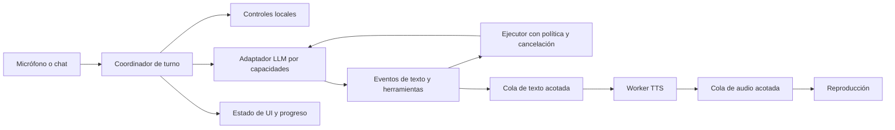

# Auditoría de rendimiento, fluidez y robustez de EzAgent

Fecha: 2026-11-10. Base revisada: `fe38ec8`. Tarea: revisión general solicitada por el propietario, sin identificador E?-T?.

> **Segunda revisión independiente (Claude Fable 5.2, 2026-11-10): ver §11.** Valida F01–F37, aporta datos medidos de esta instalación (la fila «Latencia real: No medida» de §2 queda superada), señala desacuerdos de prioridad y añade F38–F51. Las secciones 1–10 se conservan como las escribió la primera revisión.

## 1. Dictamen

EzAgent ya tiene una base útil: streaming, detección de fin de turno en un worker, precalentamiento de STT/TTS, reproducción solapada con síntesis, controles locales, política de herramientas y una suite amplia. Los problemas principales están en la propiedad del estado entre hilos, la cancelación incompleta, el trabajo síncrono en caminos críticos y un contrato LLM que todavía presupone capacidades parecidas entre modelos.

**Prioridad:** corregir cancelación, confirmaciones y estados de ejecución antes de acelerar o paralelizar más herramientas. Un fallo rápido que deja una operación ejecutándose es peor que una operación lenta con estado correcto.

No es posible garantizar idéntico tiempo de inferencia ni idéntica capacidad entre cualquier modelo de 2B y 700B. Tampoco el número de parámetros permite predecir por sí solo la latencia: influyen hardware, cuantización, contexto, servidor, concurrencia y red. Sí se puede hacer consistente la interacción: controles inmediatos, respuesta visual local, interrupción fiable, progreso honesto, contexto ajustado y degradación explícita de capacidades.

## 2. Alcance y evidencia

- Único archivo creado: este documento Markdown. No se modificaron implementación, configuración, dependencias ni pruebas.
- Revisión del flujo de voz/chat, Messenger, adaptador Anthropic, proveedores, runtime, registro/política/confirmaciones, contexto, persistencia, Herdr, watcher, sesiones de agentes, métricas y CI/evals. Inventario estructural de todo `src/`.
- **C:** comportamiento confirmado por lectura directa. **R:** además reproducido en una comprobación aislada con objetos simulados. **H:** riesgo o hipótesis cuya incidencia/coste requiere medición adicional. Una consecuencia potencial no implica que ya haya ocurrido al usuario.
- **P0:** resolver primero por integridad de acciones, autorización o confianza. **P1:** afecta fluidez, compatibilidad o fiabilidad habitual. **P2:** escalabilidad, mantenimiento o mejora posterior.
- No se hicieron llamadas pagadas a modelos, pruebas con micrófono/altavoz reales, benchmarks GPU/CPU ni ejecución de agentes reales. No se inspeccionaron secretos del usuario. Esta auditoría no certifica ausencia de otros defectos.
- Referencias `archivo:línea` corresponden a la base indicada. Los enlaces de archivo son relativos al repositorio; los nombres de función permiten localizar cada evidencia aunque cambien las líneas.

### Línea base verificada

| Comprobación | Resultado |
|---|---|
| `uv run pytest -q` antes de cambios | 1502 passed, 1 skipped; 30,19 s |
| Segunda ejecución, solo con este documento añadido | 1 failed, 1501 passed, 1 skipped; 31,64 s; fallo intermitente documentado en F37 |
| Verificación final, documento restaurado y actualizado | 1502 passed, 1 skipped; 29,71 s |
| `uv run ruff check src tests` | Sin errores |
| `uv run ruff format --check src tests` | 151 archivos ya formateados |
| Inventario AST de `src/` | 92 archivos Python; 37 011 líneas físicas |
| Tamaños estructurales | 13 módulos >600 líneas; 68 funciones >60 líneas |
| Latencia real de conversación | No medida; no hay comparación antes/después |

La prueba omitida es `tests/test_paths.py:179`: el entorno no permite crear enlaces simbólicos. La última corrida verde no elimina el defecto intermitente F37, que sigue pendiente. Los tiempos de pytest no representan mejoras de rendimiento de la aplicación.

El conteo AST incluye comentarios, docstrings, funciones anidadas y tablas: es una señal de concentración, no 68 infracciones demostradas. La regla de 600 líneas de AGENTS.md aplica a módulos nuevos; estos tamaños no establecen cuándo se introdujo cada archivo.

## 3. Hallazgos prioritarios de integridad

### F01 · P0 · C/H — Cancelar no detiene el trabajo ni aísla el estado del turno
**Evidencia:** [app.py](../src/ezagent/voice/app.py):1602,1715,1753 y [llm.py](../src/ezagent/voice/llm.py):313. `_chat_stop` cambia generación y corta TTS; el consumidor comprueba cancelación después de recibir un delta. `ask_stream` no recibe cancelación y puede seguir esperando red o ejecutando herramientas. Nuevos workers comparten Messenger y AgentRuntime; `begin_turn` reinicia contadores y taint compartidos.
**Impacto:** posible ejecución después de “detener”, mezcla de historiales, presupuestos y confirmaciones cuando se solapan turnos. **Mejora:** contexto inmutable por turno con ID, cancelación y deadline; un propietario del historial; verificar vigencia antes de cada acción y publicación; cancelar transporte cuando sea posible. **Aceptación:** interrumpir durante STT, espera del primer token, herramienta y cambio de chat; ningún turno obsoleto inicia acciones nuevas ni modifica el contexto nuevo. Una acción ya comprometida debe quedar como tal, no declararse deshecha.

### F02 · P0 · R — Una transcripción obsoleta puede resolver una confirmación actual
**Evidencia:** [app.py](../src/ezagent/voice/app.py):1103–1110. Se llama a `submit_confirmation` antes de verificar `in_call` y `gen`. La prueba simulada entregó `('transcribed', 'si', 1)` con generación actual 9 y llamada cerrada: llegó al manejador de confirmación.
**Impacto:** un “sí” retrasado puede autorizar otra operación. **Mejora:** vincular respuesta a ID de confirmación, turno y sesión; validar procedencia antes de aceptar. Conservar la excepción legítima de responder a la confirmación del turno bloqueado. **Aceptación:** respuestas antiguas, clics atrasados y eventos de otra sesión nunca resuelven la confirmación vigente.

### F03 · P0 · R — El timeout de herramientas deja el handler ejecutándose
**Evidencia:** [registry.py](../src/ezagent/agent/registry.py):140, `_call_with_timeout` hace `thread.join(timeout)` y devuelve error si sigue vivo. Reproducción con Events: devolvió timeout y después el handler completó su efecto simulado.
**Impacto:** escrituras o envíos tardíos, reintentos duplicados y acumulación de hilos. **Mejora:** cancelación cooperativa y deadline propagado; procesos controlables para trabajo que lo necesite; estados separados `timeout`, `cancel_requested`, `unknown_outcome`, `completed`; idempotencia/reconciliación para efectos externos. **Aceptación:** el timeout no se interpreta como “no ocurrió”; no se repite una escritura o envío hasta conocer su resultado.

### F04 · P0 · R/C — Desaparecer de Herdr se confunde con terminar correctamente
**Evidencia:** [watcher.py](../src/ezagent/voice/watcher.py):`_compare` emite `done/done` si desaparece un terminal antes activo. Reproducción `working → []`: evento `done`. [app.py](../src/ezagent/voice/app.py):1876 inicia cadenas cuando `reason == 'done'`.
**Impacto:** cerrar un terminal, un fallo o una respuesta incompleta pueden anunciar éxito e iniciar el siguiente agente. **Mejora:** distinguir éxito verificado, desaparición, fallo e incertidumbre; validar código de salida o evidencia estructurada cuando el backend la ofrezca; reconciliar antes de continuar cadenas. **Aceptación:** desaparecer, JSON vacío o `hc` con salida fallida no activa una cadena de éxito.

### F05 · P0 · C/H — La frontera entre instrucciones y resultados externos es inconsistente
**Evidencia:** [llm.py](../src/ezagent/voice/llm.py):733, `note_done` coloca salida literal del agente dentro de un mensaje `system`. [runtime.py](../src/ezagent/agent/runtime.py):`_TAINT_FREE_TOOLS`,344,434 excluye delegación del taint y lo reinicia en cada turno, aunque el historial conserva datos anteriores.
**Impacto:** datos externos reciben un rol privilegiado; una instrucción maliciosa puede influir en futuras delegaciones. No se reprodujo una explotación con un modelo real. **Mejora:** eventos/resultados tipados con procedencia y contenido no confiable, sin elevarlos a `system`; autorización de acciones ligada a intención del usuario; conservar procedencia al resumir y cambiar de turno. **Aceptación:** inyección en una salida y seguimiento en el turno siguiente no lanza acciones nuevas. Las delegaciones legítimas ya autorizadas deben seguir siendo fluidas.

## 4. Latencia y flujo conversacional

### F06 · P1 · C — “Listar agentes” puede bloquear el hilo principal
**Evidencia:** [app.py](../src/ezagent/voice/app.py):1118,2108 llama síncronamente a `herdr.list_agents()` desde `_handle_event`; [herdr.py](../src/ezagent/voice/herdr.py):245 permite hasta 20 s de timeout.
**Mejora:** responder desde snapshot con edad visible o consultar en worker y publicar el resultado. **Aceptación:** con Herdr bloqueado, cancelar, silenciar y abrir ajustes siguen respondiendo. Los 20 s son el timeout configurado, no una latencia observada.

### F07 · P1 · C/H — Guardar ajustes puede cargar modelos en UI y dejar cambios parciales
**Evidencia:** [app.py](../src/ezagent/voice/app.py):2686 modifica `cfg` campo a campo antes de completar validaciones; 2850 llama a `speaker.reload_model()` síncronamente. [tts.py](../src/ezagent/voice/tts.py):51 sustituye modelo/voz sin el lock usado por síntesis.
**Mejora:** validar una configuración candidata completa, preparar recursos en worker y aplicar un snapshot coherente al finalizar; cerrar recursos sustituidos después de drenar usuarios. **Aceptación:** voz inválida/modelo ausente no deja configuración parcialmente aplicada; guardar durante TTS no bloquea UI ni mezcla recursos.

### F08 · P1 · C — La síntesis de TTS pausa la lectura del streaming
**Evidencia:** [app.py](../src/ezagent/voice/app.py):1617–1624 y [speech_queue.py](../src/ezagent/voice/speech_queue.py):61: `speech.say` sintetiza en el mismo hilo que consume el generador LLM. Solo la reproducción está separada.
**Impacto:** el cliente deja de consumir tokens y llamadas a herramientas mientras sintetiza; no implica que el servidor deje de generar. **Mejora:** lector LLM → cola acotada de texto → worker TTS → cola acotada de audio → reproducción. **Aceptación:** un TTS simulado lento no retrasa el drenaje del stream hasta alcanzar el límite explícito de la cola; cancelar descarta texto/audio pendientes.

### F09 · P1 · C/H — No hay un límite coordinado de workers y audio pendiente
**Evidencia:** [speech_queue.py](../src/ezagent/voice/speech_queue.py):50 usa cola sin `maxsize`; [app.py](../src/ezagent/voice/app.py):1449,1771 crea un hilo por solicitud; F03 permite handlers huérfanos.
**Mejora:** admisión acotada, sustitución de STT obsoleto, límite de síntesis anticipada medido en segundos de audio y prioridad a cancelación/confirmación. **Aceptación:** ráfagas de entradas y respuestas largas mantienen cotas de hilos/RAM y no retrasan la interrupción. No basta con poner un `put` bloqueante en el hilo de captura.

### F10 · P1 · C — El chat con voz espera toda la respuesta
**Evidencia:** [app.py](../src/ezagent/voice/app.py):1780–1799 termina el stream y luego ejecuta `speaker.speak` sobre la respuesta completa; la voz tiene otro pipeline por frases.
**Mejora:** compartir segmentación y cola TTS, con normalización incremental del Markdown que no lea sintaxis incompleta. **Aceptación:** primer audio antes del fin de una respuesta larga, con tablas/código tratados de forma comprensible y sin duplicaciones.

### F11 · P1 · C — El acuse depende del primer evento del modelo
**Evidencia:** [llm.py](../src/ezagent/voice/llm.py):stream de `ask_stream` emite `ACK_FILLERS` cuando llega un nombre de herramienta. No cubre una espera larga anterior al primer token. El estado visual `THINKING` sí existe.
**Mejora:** mantener feedback visual inmediato y, tras una demora configurable, un único acuse local breve, cancelable y opcionalmente precalculado. Nunca afirmar que una acción ya comenzó si solo está esperando. **Aceptación:** un modelo que tarda varios segundos da señal de actividad sin rellenar cada turno con audio ni competir con la respuesta útil.

### F12 · P1 · C — STT recrea transporte y puede repetir una espera completa
**Evidencia:** [stt.py](../src/ezagent/voice/stt.py):137 usa `httpx.post` por solicitud y prueba el endpoint alternativo también tras errores HTTP de transporte. `stt_timeout_secs` es 60 s por defecto en [config.py](../src/ezagent/voice/config.py):326. Cada turno transcribe un WAV completo; unir frases vuelve a enviar audio anterior.
**Mejora:** cliente persistente, deadline total, cancelación y detección/cache del endpoint válido; fallback de ruta para incompatibilidad, no repetir automáticamente un timeout largo. Evaluar transcripción parcial solo con soporte real del backend y control de revisiones. **Aceptación:** servidor caído no consume dos presupuestos completos; una transcripción sustituida no ocupa la cola por delante de la actual.

### F13 · P2 · C/H — Fin de turno y barge-in necesitan calibración acústica
**Evidencia:** [audio.py](../src/ezagent/voice/audio.py):188,405 usa energía y duración; [app.py](../src/ezagent/voice/app.py):1368,1382 aplica ventana post-TTS y unión de audio. Hay Smart Turn y pre-roll: no falta por completo detección inteligente.
**Mejora:** medir falsos cierres, interrupciones por eco y sílabas perdidas con altavoces/auriculares, ruido y pausas naturales. Evaluar cancelación de eco o VAD adicional solo si esos datos lo justifican; no bajar todos los umbrales a ciegas. **Aceptación:** comparar precisión y latencia conjuntamente en un corpus de audio con pausas etiquetadas.

### F14 · P2 · C/H — Se abre el dispositivo de salida para cada frase
**Evidencia:** [tts.py](../src/ezagent/voice/tts.py):91 abre/cierra un stream PyAudio por reproducción; `synthesize` crea un bucle asyncio por llamada. El modelo ya permanece cargado.
**Mejora:** medir coste antes de optimizar; considerar stream persistente por dispositivo/frecuencia, caché pequeña de frases fijas y normalización sin crear un loop por frase si su API lo permite. **Aceptación:** menos huecos entre frases sin sacrificar cancelación, cambio de dispositivo ni liberar correctamente el audio.

## 5. Libertad de proveedor y tamaño de modelo

### F15 · P1 · C — Compatibilidad de formato no equivale a compatibilidad de capacidades
**Evidencia:** [llm_providers.py](../src/ezagent/llm_providers.py):19,25,210 solo distingue estilo OpenAI/Anthropic y configuración básica. [llm.py](../src/ezagent/voice/llm.py):363 envía temperatura, `max_tokens`, streaming, herramientas y esfuerzo según proveedor, no capacidades del modelo/endpoint.
**Mejora:** perfiles declarativos de capacidades y un adaptador por protocolo, con parámetros permitidos, contexto, salida máxima, tools, streaming, razonamiento y autenticación. La prueba de conexión debe verificar una petición mínima, no solo `/models`; no inventar flags ni APIs del servidor. **Aceptación:** endpoints con herramientas, sin herramientas y con parámetros restringidos funcionan o explican su limitación antes del primer turno real.

### F16 · P1 · R/C — El conjunto de herramientas es pesado y su selección pierde capacidades
**Evidencia:** [runtime.py](../src/ezagent/agent/runtime.py):`BASE_TOOLS`/`select_tool_names` ofrece hasta 14 herramientas aun en solicitudes simples. “Busca noticias de hoy y lee la página” elimina `fetch_page` porque “hoy” lo sustituye por `get_datetime`. Es reproducible sin modelo.
**Mejora:** grupos pequeños según intención y estado de tarea, preservando capacidades simultáneas; ruta determinista para controles y consultas locales. Un modelo pequeño puede operar con slots/esquemas reducidos y delegación explícita. **Aceptación:** consultas de fecha no impiden lectura web; un seguimiento mantiene las herramientas necesarias; medir acierto y tokens, no solo reducir cantidad.

### F17 · P1 · R/C — El presupuesto de contexto no refleja la petición real
**Evidencia:** [llm.py](../src/ezagent/voice/llm.py):660 reserva `3000 + llm_max_tokens`, pero `_max_tokens` eleva 320 a 1500 con tools y a 2400 en chat, reproducido. `_manage_context` ocurre antes de añadir el mensaje nuevo y solo al inicio del turno. [context.py](../src/ezagent/voice/context.py) estima con 3,2 caracteres/token y fuerza mínimo de 4000.
**Impacto:** entradas grandes o varias rondas pueden exceder contexto; ventanas pequeñas y tokenizadores distintos quedan mal representados. **Mejora:** presupuestar mensajes nuevos, resumen, esquemas reales y salida efectiva antes de cada petición; reserva conservadora calibrada con usage; limitar resultados/entradas con criterio semántico. **Aceptación:** casos de contexto 4K/8K/32K, mensaje único enorme y herramientas largas nunca envían una petición conscientemente fuera de presupuesto.

### F18 · P1 · R/C — Compactar agrega latencia y el tope de mensajes pierde memoria
**Evidencia:** [llm.py](../src/ezagent/voice/llm.py):673 resume síncronamente con el mismo modelo antes de responder; `_trim_history(60)` elimina turnos aunque no se haya resumido. Reproducción: 65 mensajes pasan a 61. El resumen no se actualiza en ese recorte.
**Mejora:** compactación anticipada sobre snapshot versionado, resumen estructurado de hechos/tareas con procedencia y límite por tokens; no truncar turnos silenciosamente por número. Si se usa otro modelo para resumir, debe ser optativo y respetar la ubicación de los datos. **Aceptación:** conservar decisiones antiguas en conversaciones largas y no compactar repetidamente cada turno en modelos de contexto pequeño.

### F19 · P1 · R — El recorte de resultados rompe JSON
**Evidencia:** [registry.py](../src/ezagent/agent/registry.py):254 serializa todo el resultado y corta la cadena a 2000 caracteres; `json.loads` falla con un resultado simulado de 3000 caracteres. `clip_old_tool_results` también recorta texto serializado.
**Mejora:** truncar campos antes de serializar, incluir `truncated`, tamaño original, cursor o referencia al artefacto; conservar estado/error y procedencia. **Aceptación:** todo resultado estructurado sigue siendo JSON válido, con información crítica intacta y forma de recuperar más contenido.

### F20 · P1 · R — La validación de esquemas es parcial
**Evidencia:** [registry.py](../src/ezagent/agent/registry.py):104,122 valida tipos/enum/rango superficial, pero no `items`, objetos anidados, longitud ni `additionalProperties`. Un esquema simulado aceptó nombre vacío, lista con tipos incorrectos y una propiedad prohibida. Algunos handlers validan además: esto no demuestra que todas las herramientas acepten esos datos.
**Mejora:** definir y cumplir un subconjunto completo del contrato, o evaluar una dependencia de validación en un brief que la autorice; validación recursiva antes de ejecutar. **Aceptación:** pruebas negativas por herramienta, argumentos parciales y tipos anidados; un JSON sintácticamente válido nunca equivale por sí solo a acción válida.

### F21 · P1 · R/C — El adaptador Anthropic pierde metadatos y recrea conexiones
**Evidencia:** [anthropic_client.py](../src/ezagent/voice/anthropic_client.py):150 omite `message_delta` con `stop_reason`/usage; reproducción: genera cero chunks para ese metadato. `iter_sse` procesa cada línea `data:` aisladamente e ignora JSON ilegible; `stream`:263 crea un `httpx.Client` por petición y `_Stream.close` lo cierra.
**Mejora:** cliente persistente con cierre explícito, eventos internos para texto/tools/usage/final/error y parser SSE con pruebas de fragmentación/multilínea. **Aceptación:** corte por límite, stream incompleto y error no se confunden con respuesta completa; medir conexión fría/caliente. La compatibilidad exacta de cada servidor requiere pruebas de contrato propias.

### F22 · P1 · C/H — Timeouts y recuperación no tienen presupuesto global
**Evidencia:** [llm.py](../src/ezagent/voice/llm.py):532 usa timeout escalar, 539 permite hasta 12 rondas más cierre, y `_open_stream` puede hacer hasta tres peticiones ante errores de argumentos. El OpenAI client desactiva retries, lo que evita algunas esperas ocultas pero no resuelve degradación prolongada.
**Mejora:** presupuesto total por turno y por fase; distinguir conexión, primer evento y silencio entre eventos; recuperación limitada para lecturas seguras; backoff visible y circuit breaker para fallos repetidos. Fallback entre proveedores solo por configuración explícita, sin mover datos locales a nube automáticamente. **Aceptación:** 429, servidor que no termina y stream a cuentagotas finalizan dentro de un presupuesto verificable sin repetir efectos externos.

### F23 · P1 · C/H — Cambiar proveedor/contexto no es una transición aislada
**Evidencia:** [llm.py](../src/ezagent/voice/llm.py):169 reemplaza cliente y mensajes sin cerrar el cliente anterior ni limpiar `summary`; [app.py](../src/ezagent/voice/app.py):2860 puede hacerlo desde ajustes durante un worker. `ChatContexts` guarda copias superficiales; su estado no representa el ciclo de vida de una petición activa.
**Mejora:** snapshot de configuración por turno y cambio transaccional de sesión; decidir explícitamente si se migra historial/resumen o se inicia uno vacío; cerrar cliente antiguo al drenar. **Aceptación:** cambiar endpoint durante generación nunca mezcla roles/resumen, ni envía la continuación al proveedor nuevo por accidente.

## 6. Agentes, persistencia y operación

### F24 · P1 · C/H — El watcher puede dejar de observar mientras procesa un aviso
**Evidencia:** [watcher.py](../src/ezagent/voice/watcher.py):`_loop` invoca callbacks desde `_compare`; [app.py](../src/ezagent/voice/app.py):1856 lee salidas y lanza cadenas dentro del callback. El periodo es duración de consulta/callback + 1 s, no exactamente 1 s. Excepciones se silencian y no se comprueba `returncode` antes de interpretar stdout.
**Mejora:** observador que solo publica snapshots/eventos; worker separado para entrega/cadenas; backoff cuando Herdr no está disponible, señal de salud y reconciliación de snapshots inválidos. **Aceptación:** un agente lento en entregar salida no retrasa detectar otro; cero éxito inferido de una consulta fallida.

### F25 · P1 · C/H — Las esperas de terminal no miden tiempo real y la recepción puede dar falsos positivos
**Evidencia:** [agent_session.py](../src/ezagent/voice/agent_session.py):`wait_ready`/`wait_shell_prompt` acumulan solo pausas, no duración de `get/read`; `_screen` devuelve vacío en errores; `confirm_submitted` puede devolver True porque no ve el prompt pendiente en ese vacío. `_run_step` añade 1 s fijo y `_check_screen` 0,7 s por intento.
**Mejora:** deadlines monotónicos, `unknown` ante lectura fallida, confirmación positiva de recepción y pausas reemplazables por condición observable. Preferir protocolo estructurado del CLI cuando exista y esté verificado; mantener fallback TUI probado. **Aceptación:** una pantalla ilegible no confirma entrega y los plazos incluyen subprocess; medir tiempo hasta tarea realmente aceptada.

### F26 · P2 · C/H — Se redescubren skills y reconstruyen herramientas por turno
**Evidencia:** [runtime.py](../src/ezagent/agent/runtime.py):315,344 llama `skills.refresh()` y `_rebuild_tools()`; [skills.py](../src/ezagent/agent/skills.py):100 redescubre carpetas. Ocurre antes del primer token, junto con persistencia de memoria.
**Mejora:** snapshots versionados de configuración/catálogos y caché invalidada por cambios; no cachear decisiones de permiso, confirmaciones ni resultados de escritura. **Aceptación:** sin cambios de archivos, un nuevo turno no reconstruye todo; una edición de permisos entra en vigor de forma atómica. Medir primero el coste: no se ha demostrado que sea el mayor cuello de botella.

### F27 · P1 · C/H — Recargar permisos deja dependencias con configuración anterior
**Evidencia:** [runtime.py](../src/ezagent/agent/runtime.py):315 asigna una nueva `self.config` y recrea prompt/confirmación; `MemoryStore`, `SkillLibrary`, `Journal` y `AuditLog` se crearon en `__init__` y no se reconstruyen allí.
**Mejora:** distinguir ajustes recargables de los que requieren reinicio; reconstruir el grafo afectado o rechazar claramente un cambio no soportado. **Aceptación:** cambiar rutas/límites de memoria/skills no mantiene silenciosamente la ruta o política antigua. No todas las propiedades tienen necesariamente el mismo efecto: verificar cada una.

### F28 · P1 · C/H — Apagado sin drenaje completo de workers
**Evidencia:** [app.py](../src/ezagent/voice/app.py):944 detiene señales y cierra recursos de audio/auditoría sin reunir todos los workers; [watcher.py](../src/ezagent/voice/watcher.py):`stop` solo activa Event. `Messenger` no expone cierre completo del ciclo de vida.
**Mejora:** supervisor de workers con cierre por etapas y plazo máximo: impedir tareas nuevas, cancelar, drenar, cerrar transporte/audio y persistir estados inciertos. **Aceptación:** cerrar durante síntesis, STT, herramienta y confirmación no usa recursos ya cerrados ni deja estados de éxito falsos.

### F29 · P1 · C/H — Los errores no llevan identidad de turno
**Evidencia:** [app.py](../src/ezagent/voice/app.py):1598,1646,1680 publica `('error', mensaje)` sin generación; `_handle_event`:1186 lo procesa aunque el turno original ya terminó. Otros eventos sí incluyen generación.
**Mejora:** eventos tipados con sesión, turno, fase y origen; descartar errores obsoletos de conversación, conservando fallos globales de dispositivo. **Aceptación:** el timeout del STT anterior no interrumpe la respuesta actual con un aviso atrasado.

### F30 · P2 · C/H — El historial crece y se recorre completo
**Evidencia:** [chat/store.py](../src/ezagent/voice/chat/store.py):69 carga el JSONL entero a RAM; 195 reescribe el archivo al borrar una sesión. [chat/session.py](../src/ezagent/voice/chat/session.py):254 copia mensajes para el snapshot; [chat/contexts.py](../src/ezagent/voice/chat/contexts.py) conserva contextos de sesiones sin política de expulsión.
**Mejora:** paginación e índice por sesión, límites de caché y almacenamiento transaccional; SQLite ya forma parte del uso de la biblioteca estándar en memoria. **Aceptación:** medir carga, cambio y borrado con historiales grandes; mantener tiempos/RAM acotados. No se ejecutó ese benchmark y no se atribuye un lag de render concreto.

### F31 · P1 · C/H — Las métricas actuales no permiten comparar modelos con precisión
**Evidencia:** [metrics.py](../src/ezagent/voice/metrics.py):`LatencyStats.record` guarda tiempos sin modelo/backend/tokens/estado; [app.py](../src/ezagent/voice/app.py):1132 omite turnos invalidados. `_timed_stream` atribuye a LLM el tiempo dentro de `next()`, que puede incluir preparación, compactación y herramientas. `first_sound` se marca antes de `stream.write`, no por captura del audio realmente audible.
**Mejora:** spans por etapa y ronda, resultado/cancelación, tamaño de entrada/salida, cola y snapshot de capacidades; separar primer acuse de primer contenido útil. **Aceptación:** P50/P95/P99 por escenario y perfil, incluyendo errores/cancelaciones; el informe diferencia latencia de app, modelo y dispositivo.

### F32 · P2 · C — Concentración de responsabilidades y contratos débiles
**Evidencia:** inventario: `app.py` 3485 líneas, `menu.py` 3865, `drop.py` 2117, `layered.py` 1494. `Messenger.ask_stream` 213 líneas y `_apply_settings` 203. Eventos como tuplas posicionales, callbacks y abundante `Any` dificultan comprobar límites de propiedad.
**Mejora:** extraer por responsabilidad con contratos tipados y pruebas de comportamiento: coordinador de turno, proveedores, audio, configuración, delegación y almacenamiento. **Aceptación:** cambios pequeños con pruebas verdes; ningún refactor masivo ni migración a microservicios por principio. Extraer un monolito sin aclarar propiedad del estado no resuelve F01.

### F33 · P1 · C/H — Diagnóstico inconsistente y posible exposición de contenido sensible
**Evidencia:** [audio.py](../src/ezagent/voice/audio.py):507 imprime desde captura con `flush`; [metrics.py](../src/ezagent/voice/metrics.py) usa `print`, el registro usa `logging` y otros módulos `loguru`. [app.py](../src/ezagent/voice/app.py):1116,1664 registra transcripción/respuesta; [llm.py](../src/ezagent/voice/llm.py):99 devuelve `str(exc)` y el adaptador Anthropic incluye cuerpo de error. Hay redacción en auditoría, pero no es un filtro universal de estos canales.
**Mejora:** loguru con cola, redacción común, mensajes de error públicos estables y retención/configuración de contenido; no bloquear audio por stdout. **Aceptación:** secretos ficticios reflejados por un endpoint no aparecen en voz/logs; fallos de disco/stdout no paran captura. No se observó una clave real expuesta.

### F34 · P2 · C — Documentación y controles automáticos no cubren el comportamiento actual
**Evidencia:** [architecture.md](architecture.md) describe cuatro rondas; el código usa ocho por defecto más cierre. Sus 150–250 ms de STT no incluyen un entorno reproducible. [ci.yml](../.github/workflows/ci.yml) ejecuta pytest y lint en Python 3.11/3.13, pero no format-check, type-check ni evals offline.
**Mejora:** actualizar contratos desde configuración/código, documentar hardware y medición de cifras, y agregar a CI controles relevantes ya disponibles. **Aceptación:** documentación y defaults coinciden; ninguna cifra de rendimiento se presenta como garantía universal. No hace falta ampliar indiscriminadamente todos los jobs.

### F35 · P1 · C — Los evals actuales no acreditan paridad entre modelos
**Evidencia:** [evals/provider.py](../evals/provider.py):`_RecordingRuntime` simula herramientas y `_guard_second_call` corta antes de la segunda llamada. Es útil para primer paso; no prueba recuperación, cierre multirronda, cancelación o audio. La suite unitaria verde no sustituye esas pruebas.
**Mejora:** conservar esos evals y añadir escenarios multivuelta con runtime controlado, matriz de capacidades/modelos y métricas de latencia, herramientas correctas, seguridad y éxito final. **Aceptación:** un modelo se considera apto para un perfil por resultados medidos; los modelos sin tools también tienen una ruta probada y limitada.

### F36 · P1 · H — La comprobación DNS no fija el destino de la conexión web
**Evidencia:** [tools_web.py](../src/ezagent/agent/tools_web.py):`_validate_public_url` resuelve/verifica IP y devuelve la URL original; `_download_page_text` la entrega a un transporte que resuelve para conectar. Ya hay defensas importantes: bloqueos de IP privadas, límites de tamaño y revalidación de redirecciones.
**Riesgo:** ventana entre validación y conexión ante cambio de DNS; no se probó un ataque real. **Mejora:** transporte que conecte al destino validado preservando Host/TLS/SNI o verifique efectivamente el peer; aplicar por salto. **Aceptación:** prueba local simulada con resolución cambiante bloquea la segunda IP privada sin romper TLS legítimo.

### F37 · P2 · R — El orden de conversaciones depende de empates del reloj
**Evidencia:** [chat/store.py](../src/ezagent/voice/chat/store.py):263–278 ordena por máximo `time.time()` de mensajes y desempata por ID de sesión descendente. `resume` no registra recencia en memoria para ese orden. Falló `tests/test_chat_contexts.py:122`: esperaba la sesión 1 retomada y recibió la 2. Los timestamps persistidos se redondean además a milisegundos, aumentando empates tras reiniciar.
**Comprobación de base:** se guardó exclusivamente este documento con `git stash push --include-untracked -- docs/performance-robustness-audit.md`; con árbol limpio se invocó la prueba existente en un directorio temporal y reloj constante: reprodujo el AssertionError. La prueba aislada con reloj real pasó (1 passed, 0,27 s). Se restauró y eliminó únicamente ese stash. No se modificó la prueba ni el código.
**Mejora:** secuencia persistida de actividad/reanudación como desempate, independiente de resolución o ajustes del reloj; prueba con timestamps idénticos y reinicio. **Aceptación:** retomar una sesión la coloca primero incluso sin escribir y con reloj empatado/retrocediendo. Es un defecto preexistente, no una regresión producida por el documento.

## 7. Arquitectura objetivo incremental

- El coordinador posee sesión/historial y transiciones; los workers producen eventos, no mutan estado global. Cancelación y confirmación tienen identidad propia. Un supervisor limita concurrencia y controla cierre.
- La interfaz del proveedor normaliza texto, herramientas, uso, fin y errores. El dominio no conoce `choices[0].delta` ni excepciones del SDK. Endpoint, modelo y protocolo siguen configurables.
- El ejecutor preserva política, validación, auditoría y procedencia. Paralelizar solo lecturas independientes tras resolver F01/F03; mantener orden para escrituras, confirmaciones y operaciones sobre la misma sesión de agente.
- Contexto, tools y salida se ajustan a capacidades reales. Modelo sin herramientas: conversación/control local/delegación determinista disponible, sin interpretar texto libre como comandos. Modelo con tools limitadas: esquemas pequeños y tareas acotadas. Modelo avanzado: más planificación dentro de un presupuesto explícito.
- No exigir un segundo LLM. Un router o resumidor adicional debe ser optativo, medido y compatible con la preferencia local/API del usuario. Nunca hacer fallback silencioso de local a nube.

## 8. Qué medir y qué significa “igual de fluido”

Tiempo hasta contenido hablado útil ≈ cierre de turno + STT + preparación/cola + espera del modelo + acumulación de primera frase + TTS inicial + apertura/buffer de audio. Las etapas posteriores se solapan; sumar sus duraciones acumuladas no reconstruye necesariamente el tiempo total.

| Métrica | Criterio inicial propuesto, no resultado observado |
|---|---|
| Feedback visual de entrada/stop | P95 ≤100 ms en equipo de referencia, incluso con backend lento |
| Cancelación desde evento de control hasta cortar audio | P95 ≤150 ms, excluyendo tiempo acústico para detectar barge-in |
| Captura de 30 ms por bloque | Trabajo de callbacks por debajo del presupuesto; sin red/disco síncronos |
| Primer audio útil y primer texto útil | P50/P95/P99 por perfil; separar acuse local y respuesta |
| Éxito de herramientas/delegación | Resultado verificado, sin duplicados ni ejecución nueva tras cancelación |
| Recursos | Cotas explícitas de workers, segundos de audio pendiente, RAM y CPU en reposo |
| Calidad | Exactitud de intención/argumentos, falsas interrupciones, pérdida de contexto y tareas completadas |

Banco mínimo: misma entrada grabada/texto, 10 calentamientos y al menos 100 repeticiones para latencia por escenario; frío/caliente separados; registrar hardware, SO, modelos, cuantización, backend y versiones. Ampliar muestra para estimar P99 con estabilidad. Empezar con backends simulados de demora/error antes de gastar tokens en la matriz real.

Escenarios: control local; respuesta breve; delegación; consulta con dos lecturas independientes; confirmación; interrupción antes del primer token/durante TTS; contexto pequeño lleno; error 429/timeout; modelo sin tools; STT caído; tres agentes terminando juntos; Herdr desaparecido; guardar ajustes durante generación; conversación extensa; caída y reinicio durante un envío. Comparar por capacidades, no solo por parámetros.

## 9. Orden de implementación recomendado

| Etapa | Hallazgos | Entrega y criterio para avanzar |
|---|---|---|
| A · Integridad | F01–F05, F29 | Estado por turno, confirmación identificada, timeout honesto y finalización verificada; regresiones reproducidas pasan |
| B · Camino interactivo | F06–F12, F24–F25, F28 | UI sin subprocess/carga de modelos, pipeline TTS separado, colas acotadas y cierre controlado |
| C · Compatibilidad | F15–F23, F27 | Adaptadores/capacidades, presupuesto real, JSON válido, validación y cambios de perfil coherentes |
| D · Medición y escala | F13–F14, F26, F30–F37 | Instrumentación, benchmarks, historial estable, modularización por responsabilidad y evals de conversación completa |

F31 debe instrumentarse desde A para medir cada entrega; F36 puede corregirse de forma independiente sin esperar D. Para cada brief posterior, declarar archivos autorizados, mantener pasos alrededor de 300 líneas y ejecutar pruebas. No añadir dependencias ni cambiar modelos por este documento.

## 10. Registro de reproducciones y límites

Pruebas auxiliares ejecutadas en memoria, sin agentes reales ni escritura de archivos del proyecto: handler continúa después de timeout (F03); transcripción obsoleta llega a confirmación (F02); desaparición produce `done` (F04); esquema incompleto acepta datos inválidos (F20); resultado recortado no es JSON (F19); 65→61 mensajes sin resumir (F18); límite 320→1500/2400 (F17); “hoy” elimina `fetch_page` (F16); metadatos finales Anthropic producen cero chunks (F21).

Estas reproducciones demuestran mecanismos concretos, no su frecuencia en producción. Falta medir latencia completa, carga, acústica, consumo y comportamiento real de cada modelo. El documento reúne 37 hallazgos/propuestas identificados; no promete haber enumerado todos los defectos posibles. F37 añade una reproducción determinista del fallo intermitente observado en la suite.

Decisiones de alcance: Markdown versionable en `docs/`; revisión sin cambios funcionales; evidencia y recomendaciones separadas; objetivos de rendimiento declarados como propuestas. No se introdujeron decisiones de implementación ni comentarios `# DECISION` en código.

## 11. Segunda revisión independiente (Claude Fable 5.2)

Fecha: 2026-11-10, misma base `fe38ec8`. Primero se revisó el código sin leer las secciones 1–10; después se contrastó cada hallazgo. Único archivo modificado: este documento.

### 11.1 Método y límites

- Lectura completa de `llm.py`, `anthropic_client.py`, `tool_json.py`, `context.py`, `registry.py`, `runtime.py`, `system_prompt.py`, `speech_queue.py`, `tts.py`, `stt.py`, `turn.py`, `watcher.py`, `condenser.py`, `metrics.py`, `llm_providers.py`, `search.py`, `chat/store.py`; lectura de los caminos de turno, chat, watcher, atajos y ajustes de `app.py`; lectura parcial de `audio.py`, `herdr.py`, `agent_session.py`, `confirm.py`, `tools_web.py`, `config.py`.
- **M** (nuevo): medido en datos reales de esta instalación. Se analizaron `%APPDATA%/EzAgent/logs/latency.jsonl` (190 turnos, 8–10 nov) y `logs/audit.jsonl` (173 registros); solo tiempos, nombres de herramienta y decisiones. De `voice.json` se leyeron ajustes de modelo y VAD, nunca claves.
- Reproducciones nuevas en memoria con dobles de proveedor/runtime (sin red ni escritura en el proyecto): F38 (tres casos), F41, F44. Medición del prompt con el runtime real sobre una carpeta temporal: F39.
- No se revisó a fondo la UI del notch (`menu.py`, `drop.py`, `layered.py`, `settings.py`, ~9 000 líneas), el interior de `memory.py`, `tools_fs.py`, `tools_herdr.py` ni los scripts de skills. Sin llamadas pagadas, sin pruebas con audio real, sin modelos locales. Los datos **M** son de una sola máquina y un solo proveedor.
- Verificación al cierre: `uv run pytest -q` → 1504 passed, 1 skipped (29,5 s); `ruff check` y `ruff format --check` sin errores. El árbol tenía cambios ajenos en curso en `voice/notch/` y tres archivos de `tests/` (por eso 1504 y no 1502); no se tocaron y ninguno afecta a los archivos citados aquí.

### 11.2 Datos medidos

**Tiempo hasta el primer audio.** 107 turnos con el formato de registro actual (2026-11-09 15:21 → 2026-11-10 15:20). El registro no guarda proveedor ni modelo (F31); la configuración vigente es `opencode` / `deepseek-v4.1-flash`, `llm_reasoning_effort=none`, `silence_secs=1.3`, Smart Turn activo, Whisper `large-v3-turbo-q5_0`, Kokoro `int8`.

| Etapa (ms) | Media | P50 | P90 | P95 | Parte del primer audio |
|---|---|---|---|---|---|
| Espera de fin de turno (VAD) | 587 | 391 | 1297 | 1297 | 17 % |
| STT | 193 | 172 | 241 | 281 | 6 % |
| LLM hasta el primer token | 1994 | 1688 | 3309 | 3469 | 59 % |
| Acumular la primera frase | 91 | 62 | 141 | 272 | 3 % |
| Síntesis + apertura hasta el primer sonido | 520 | 485 | 693 | 719 | 15 % |
| **Primer audio desde el fin de la voz** | 3405 | 3156 | 4731 | 5356 | 100 % |

- Solo 6 de 107 turnos tuvieron el primer token en menos de 1 s; 17 pasaron de 3 s. La preparación previa a la petición (evento, hilo, atajos) es de 16 ms en P50.
- Fin de turno: 84 turnos cerraron rápido (≈0,39 s, Smart Turn) y 23 esperaron el silencio completo (1,3 s). Primer audio P50: 2,88 s con cierre rápido frente a 3,78 s con silencio completo.
- Kokoro sintetiza a 0,29× del tiempo real en P50 (n=104): el TTS no limita la voz, la limita la reproducción.
- Los 77 turnos con el formato anterior tenían 2,7 s (P50) entre primera frase y primer sonido; hoy son 0,49 s. La cola de voz y la primera cláusula corta ya dieron ese resultado.
- `begin_turn` cuesta ~54 ms por turno en esta máquina (44 ms son `skills.refresh`): alrededor del 3 % del tiempo al primer token.

**Uso real de herramientas** (`audit.jsonl`): `delegate_to_agent` 113 (65 %), `web_search` 25, `fetch_page` 13, `voice_control` 12; esas cuatro suman el 94 %. El resto de las 20 herramientas registradas suma 10 usos. De 114 turnos con herramientas, 9 llegaron al tope de 4 llamadas. `web_search`: P50 2 953 ms y 9 de 25 fallidas. `fetch_page`: P50 563 ms, 3 de 13 fallidas. `delegate_to_agent`: P50 109 ms, P90 2 547 ms, máximo 37 109 ms. Confirmaciones: 6 aceptadas y 4 `confirm_no`.

**Tamaño fijo de cada petición** (runtime real, skills y agentes de fábrica, memoria vacía, sin ventanas de Herdr): prompt de sistema 11 305 caracteres + 14 esquemas 10 775 caracteres = 22 080 caracteres, unos 6 900 tokens con el estimador propio (3,2 caracteres/token). `delegate_to_agent` solo ocupa 3 944 caracteres; el catálogo de skills, 4 918.

### 11.3 Validación de F01–F37

«Leído» = evidencia comprobada en el código. «Reproducido» = vuelto a ejecutar en esta revisión. Las prioridades propuestas aquí sustituyen a las originales solo donde se indica.

| ID | Veredicto | Nota |
|---|---|---|
| F01 | De acuerdo, P0. Reproducido | El daño es mayor que el descrito: persiste en el historial (F38). No hace falta el coordinador completo para cerrarlo (11.4-D7). |
| F02 | De acuerdo. Leído | Además cualquier frase sin aceptación resuelve como rechazo y el plazo corre durante el TTS (F48). |
| F03 | De acuerdo, P0. Leído | Remedio más simple en 11.4-D6. |
| F04 | De acuerdo, P0. Leído | Es el P0 más probable en la práctica: si `hc` falla una vez y deja stdout vacío, `watcher.py:56` lo lee como `{}` y **todos** los agentes vigilados que trabajaban pasan a `done`, con sus cadenas. |
| F05 | De acuerdo. Leído | Suma un problema de compatibilidad: `system` a mitad de conversación (F43). |
| F06 | De acuerdo. Leído | `app.py:2108` en el hilo de Tk. |
| F07 | De acuerdo. Leído | El `ValueError` de `app.py:2800-2803` llega después de mutar ~40 campos. |
| F08 | Mecanismo correcto; impacto distinto | 11.4-D3. |
| F09 | De acuerdo en el mecanismo; bajar a P2 | 11.4-D4. |
| F10 | De acuerdo. Leído | `chat_voice` está apagado en esta instalación: impacto actual nulo aquí. |
| F11 | De acuerdo; subir dentro de P1 | El usuario espera 3,2 s (P50) sin oír nada; es la mejora percibida más barata. |
| F12 | Rendimiento: bajar a P2. Robustez: mantener | 11.4-D2. |
| F13 | Subir la parte de fin de turno a P1 | 11.4-D5 y F46. |
| F14 | De acuerdo, P2 | Cota medida: síntesis + apertura de la primera frase suman 485 ms en P50; abrir el dispositivo no puede costar más que eso. |
| F15 | De acuerdo. Leído | Casos concretos en F42 y F43. |
| F16 | De acuerdo. Reproducido | Hay un caso peor (F41) y el uso real respalda reducir el conjunto (11.2). |
| F17 | De acuerdo. Leído | Con el tamaño medido, la condición de compactar es verdadera desde el primer turno si `llm_context_tokens` ≤ ~9 800 (F39). |
| F18 | De acuerdo. Leído | Con 32 000 tokens, el tope de 60 mensajes actúa **antes** que la compactación salvo que el promedio supere ~830 caracteres por mensaje: en voz, perder turnos sin resumen es el camino normal, no la excepción. |
| F19 | De acuerdo. Leído | — |
| F20 | Mecanismo correcto; bajar a P2 | 11.4-D8. |
| F21 | De acuerdo. Leído | Un cliente nuevo por petición implica una conexión TLS nueva en cada ronda de herramientas. |
| F22 | De acuerdo. Leído | `llm.py:537` solo acepta timeouts de 1 a 120 s (un valor mayor vuelve a 30 s): un modelo local que tarde más en evaluar el prompt se informa como «No pude conectar». Hay dos presupuestos sin relación (8 rondas en `voice.json`, 4 llamadas en `permissions.toml`). |
| F23 | De acuerdo. Leído | El condensador conserva el cliente anterior (F44). |
| F24 | De acuerdo. Leído | El callback también puede llamar al LLM (`_packet_for` → condensador) dentro del hilo del watcher. |
| F25 | De acuerdo. Leído parcialmente | Comprobados `wait_ready`, `wait_shell_prompt` y `_screen`. |
| F26 | De acuerdo, P2. Medido | ~54 ms por turno. |
| F27, F28, F29 | De acuerdo. Leído | — |
| F30 | De acuerdo, P2. Leído | `sessions()` recorre todas las entradas por cada sesión (cuadrático). |
| F31 | De acuerdo; hacerlo primero | Sin modelo/proveedor en `latency.jsonl`, los datos de 11.2 no se pueden comparar entre modelos. |
| F32, F33, F34, F35 | De acuerdo. Leído | — |
| F36 | De acuerdo como riesgo (H). Leído | — |
| F37 | De acuerdo. Leído, no reproducido de nuevo | La suite pasó completa en esta revisión; el defecto de orden sigue en el código. |

### 11.4 Desacuerdos y ajustes

- **D1 · «Latencia no medida».** Sí hay datos: la app los registra. Cambian el orden: el modelo es el 59 % del tiempo al primer audio, el fin de turno el 17 %, el TTS el 15 % y el STT el 6 %. Las etapas B y C de §9 deberían ordenarse según ese reparto (11.6).
- **D2 · F12.** Con STT en 172 ms (P50), un cliente HTTP persistente ahorraría pocos milisegundos: P2. Lo que sí importa es el timeout de 60 s aplicado dos veces (hasta 120 s antes de avisar) para un servidor local que nunca pasó de 906 ms: bajarlo a ~10 s y cachear el endpoint válido.
- **D3 · F08.** Kokoro va 3,4 veces más rápido que el audio, así que sintetizar en el hilo lector no retrasa la voz. Lo que retrasa es el **inicio de la herramienta**: el modelo emite «Va, lo reviso.» y luego la llamada, y el lector no llega a la llamada hasta terminar de sintetizar el acuse (hasta ~0,5 s en cada turno con herramientas). También congela el texto del chat. Basta mover `synthesize` a un hilo propio dentro de `SpeechQueue`; no hacen falta dos colas acotadas nuevas.
- **D4 · F09.** La respuesta de voz está limitada por `llm_max_tokens` (320) y los hilos por el ritmo del habla; el riesgo de memoria es teórico. P2. Sí conviene descartar el STT obsoleto.
- **D5 · F13.** Clasificado P2 «si los datos lo justifican»: los datos lo justifican para el fin de turno. Uno de cada cinco turnos paga 1,3 s y Smart Turn se consulta una sola vez por pausa (F46). El resto de F13 (eco, VAD adicional) sigue en P2.
- **D6 · F03, remedio.** «Procesos controlables» es más de lo necesario. Los handlers son E/S con timeout propio (httpx, subprocess): basta garantizar que el timeout interno sea menor que el del registro, de modo que el handler termine solo, y reservar `unknown_outcome` para herramientas de escritura o envío.
- **D7 · §7, tamaño del primer paso.** De acuerdo con la dirección. Para cerrar F01/F38 no hace falta construir antes el coordinador de turno: exclusión mutua por `Messenger` (un turno a la vez), un token de cancelación consultado antes de cada `runtime.execute` y antes de abrir cada ronda, y una reparación estructural del historial antes de cada petición. Cabe en un brief de menos de 300 líneas y no bloquea el rediseño posterior.
- **D8 · F20.** La demostración usa un esquema simulado; los esquemas reales son planos y varios handlers validan por su cuenta. P2 hasta mostrar una herramienta real que acepte datos anidados inválidos.
- **D9 · «Igual de fluido con 2B o 700B».** De acuerdo con el párrafo de §1, con una precisión: con el prompt actual (≈6 900 tokens y 14 herramientas) un modelo pequeño o de ventana corta no puede funcionar, sea cual sea su velocidad. La paridad de sensación exige tres cosas que hoy faltan: acuse local independiente del modelo (F11), prompt y herramientas por perfil (F39) y prefijo estable para la caché (F40).

### 11.5 Hallazgos nuevos

#### F38 · P0 · R — Cancelar o solapar turnos deja el historial dañado de forma permanente
**Evidencia:** [llm.py](../src/ezagent/voice/llm.py):313-525 no tiene exclusión entre turnos y cede el control (`yield`) en 431, 436, 466 y 491; [tool_json.py](../src/ezagent/voice/tool_json.py):80 solo repara el JSON de los argumentos, no la estructura. Tres reproducciones: (a) turno 1 dentro de una herramienta, «detener» y turno 2 → historial `user, assistant+tool_calls, user, assistant, tool, assistant`, y el turno detenido hizo una tercera petición al proveedor; (b) cancelar en el aviso de fallo de `llm.py:491` → `assistant+tool_calls` sin resultado, enviado tal cual en la petición siguiente; (c) cancelar antes de la respuesta → dos `user` seguidos y el texto ya dicho no queda en el historial.
**Impacto:** las API de OpenAI y Anthropic rechazan una llamada sin su resultado (comportamiento documentado; no ejecutado aquí). Ese error no contiene el texto que busca `is_tool_json_error`, así que no se activa la recuperación y las peticiones siguientes fallan hasta que ese tramo salga del historial o se inicie una conversación nueva. El turno detenido sigue gastando tokens. **Mejora:** D7; al cancelar, cerrar las llamadas abiertas con un resultado sintético «cancelado por el usuario» y guardar el texto parcial marcado como interrumpido. **Aceptación:** tras cualquier cancelación la siguiente petición es estructuralmente válida; un turno detenido no abre peticiones ni ejecuta herramientas nuevas.

#### F39 · P1 · M — Cada petición carga ~6 900 tokens fijos y casi todo el uso real se concentra en cuatro herramientas
**Evidencia:** 11.2. `ctx_mgr.MIN_BUDGET` es 4 000 y la reserva para esquemas es 3 000 ([llm.py](../src/ezagent/voice/llm.py):667), menos que los esquemas reales (~3 370).
**Impacto:** con ventanas de 4K–8K el prompt no cabe o deja sin espacio a la conversación; hasta ~9 800 tokens se intenta compactar desde el primer turno; en modelos locales evaluar ese prompt domina el primer token; en API se paga en cada ronda (hasta 9 por turno). **Mejora:** núcleo de prompt corto y secciones bajo demanda; conjunto base de 4–5 herramientas según uso, con el resto por intención; dividir `delegate_to_agent`; catálogo de skills reducido a nombres. Tres perfiles: sin herramientas, reducido, completo. **Aceptación:** tokens fijos por perfil medidos y registrados; el perfil reducido cabe holgado en 8K; el acierto de herramientas no baja en los evals.

#### F40 · P1 · C/H — Los datos volátiles van dentro de `messages[0]` e invalidan la caché de toda la conversación
**Evidencia:** [system_prompt.py](../src/ezagent/agent/system_prompt.py):270-277 pone memoria, ventanas de Herdr y hora al final del prompt de sistema, pero el historial completo va detrás. [herdr.py](../src/ezagent/voice/herdr.py):291 incluye `age_seconds` con décimas: cambia en cada turno. [llm.py](../src/ezagent/voice/llm.py):341-344 añade el resumen y el bloque de chat al mismo mensaje (alternar voz y chat lo cambia). [runtime.py](../src/ezagent/agent/runtime.py):97-108 cambia el conjunto de herramientas según palabras del usuario. [anthropic_client.py](../src/ezagent/voice/anthropic_client.py):245-261 no envía `cache_control`.
**Impacto (H, sin medir):** un servidor local que reutiliza el prefijo evaluado reprocesa todo el historial en cada turno; en API se pierde el descuento y la latencia de entrada cacheada. En la API Messages la caché es optativa: verificar contra su documentación antes de implementarlo. **Mejora:** sistema y herramientas estables por sesión; lo volátil en un bloque final junto al turno del usuario; quitar `age_seconds` o reducirlo a «reciente/antiguo»; `cache_control` en el adaptador. **Aceptación:** dos turnos seguidos sin cambios de configuración comparten byte a byte todo el prefijo anterior al turno nuevo; registrar tokens cacheados cuando el proveedor los informe.

#### F41 · P1 · R — La rotación de herramientas puede dejar una skill sin poder ejecutarse
**Evidencia:** [runtime.py](../src/ezagent/agent/runtime.py):97-98 y 107-108: «hoy/día/fecha/hora» y `run_skill_script` sustituyen ambos a `fetch_page`. `select_tool_names("hoy genera el PDF del informe", scripts_loaded=True)` no contiene `run_skill_script`; sin «hoy», sí. `begin_turn` vacía `_loaded_skills` (línea 350), así que un seguimiento («ahora ejecútalo») tampoco la ofrece.
**Mejora:** sumar capacidades por intención en lugar de sustituir posiciones; conservar las skills cargadas mientras dure la tarea. **Aceptación:** esas dos frases ofrecen `run_skill_script`.

#### F42 · P1 · C/H — Modelos de razonamiento y respuestas vacías no tienen tratamiento
**Evidencia:** [llm.py](../src/ezagent/voice/llm.py):428-431 solo lee `delta.content`; no hay filtro de bloques de pensamiento ni lectura de `reasoning_content` en todo `src/`. `finish_reason == "length"` no se trata. Si el contenido llega vacío (515-519) se guarda un mensaje vacío: en voz no suena nada ni se avisa ([app.py](../src/ezagent/voice/app.py):1659-1664); el chat sí avisa (1785-1786). El catálogo propio ofrece `o4-mini`, `deepseek-r1-distill-llama-70b` y `deepseek-reasoner` ([llm_providers.py](../src/ezagent/llm_providers.py):122-145) y la petición envía `max_tokens` y temperatura 0,3 a todos (366-373).
**Impacto (H, sin llamadas pagadas):** con 320 tokens el razonamiento puede agotar la salida y dejar silencio; un modelo que escribe su pensamiento dentro de `content` sería leído en voz alta; algunas familias rechazan `max_tokens` o una temperatura distinta de la predeterminada. **Mejora:** dentro de F15: campo de salida y parámetros por perfil, descartar pensamiento antes del TTS, y en voz tratar la respuesta vacía o cortada con un aviso breve. **Aceptación:** un modelo de razonamiento simulado nunca produce silencio ni lectura de su razonamiento.

#### F43 · P1 · R/H — El historial usa secuencias de roles que no todos los modelos aceptan
**Evidencia:** mensajes `system` a mitad de conversación en [llm.py](../src/ezagent/voice/llm.py):377-388 (cierre), 393-402 (presupuesto, en cada ronda con herramientas) y 746 (`note_done`); dos `user` consecutivos tras cancelar (F38-c).
**Impacto (H):** plantillas de chat de modelos locales que exigen alternancia estricta o solo admiten `system` al inicio fallan o lo ignoran; no se probó con servidores reales. **Mejora:** normalizador por perfil antes de enviar: fusionar `user` consecutivos y convertir avisos internos en un bloque de usuario etiquetado como dato (resuelve a la vez la mitad de F05). **Aceptación:** para el perfil estricto, toda petición alterna roles y solo tiene `system` al inicio.

#### F44 · P1 · R/C — El condensador sigue en el proveedor anterior y no funciona con el formato Anthropic
**Evidencia:** [app.py](../src/ezagent/voice/app.py):1941-1943 crea `_condenser` una sola vez con el cliente de ese momento; `reload_llm` reemplaza `messenger.client` y nadie lo actualiza. [condenser.py](../src/ezagent/voice/condenser.py):54-55 espera una respuesta sin streaming, pero el adaptador Anthropic siempre devuelve un stream: reproducido, devuelve `None` y deja la petición abierta sin cerrar.
**Impacto:** tras cambiar de proveedor (por ejemplo de nube a local) la salida de los agentes se sigue enviando al endpoint anterior; con Anthropic se paga una petición inútil en cada entrega. Además se ejecuta en el hilo del watcher (F24). **Mejora:** pedir el cliente al `Messenger` en cada uso, una función de texto completo común a ambos formatos y ejecución fuera del watcher. **Aceptación:** tras cambiar de proveedor ninguna petición sale al anterior; con el adaptador Anthropic el condensador devuelve un número y cierra la conexión.

#### F45 · P1 · C — El hilo de captura cambia el estado del turno, toca la UI y puede escribir en disco
**Evidencia:** [audio.py](../src/ezagent/voice/audio.py):590-600 invoca los callbacks dentro del bucle de lectura del micrófono. En [app.py](../src/ezagent/voice/app.py), `_on_barge_in`, `_on_speech_start` y `_on_utterance` incrementan `_turn_gen` (1339, 1387, 1446) sin lock, igual que el hilo principal (1250, 1290, 1508, 1717, 1764), y llaman a `_set_state` (1454-1478), que muestra la barra, actualiza la bandeja y, si la barra estaba oculta, ejecuta `cfg.save_key` (1474).
**Impacto:** contradice las reglas de AGENTS.md sobre hilos de audio y estado compartido; una carrera en `_turn_gen` puede dar por vigente un turno obsoleto. No se observó un fallo concreto. **Mejora:** los callbacks solo cortan el TTS (ya es seguro) y encolan un evento; el hilo principal decide generación y estado. **Aceptación:** `_turn_gen` y `state` solo cambian en el hilo principal; el corte por interrupción no empeora.

#### F46 · P1 · M/C — El fin de turno se sondea una sola vez por pausa
**Evidencia:** [audio.py](../src/ezagent/voice/audio.py):340-358: tras `turn_quick_secs` se hace una consulta a Smart Turn (`_probed`) y, si dice «no terminó», se espera `silence_secs` completo. Datos: 23 de 107 turnos esperaron 1,3 s; la espera es el 17 % del tiempo al primer audio.
**Mejora:** volver a sondear durante la misma pausa (por ejemplo a 0,6 y 0,9 s) o acortar el silencio según la probabilidad. Los falsos cierres ya dejan rastro («Sigues hablando: uno esta frase…»): contarlos antes y después. **Aceptación:** baja la proporción de turnos que esperan el silencio completo sin que suba la de frases unidas.

#### F47 · P1 · M — La búsqueda web tarda ~3 s y falla una de cada tres veces, y la auditoría no dice por qué
**Evidencia:** 11.2. [search.py](../src/ezagent/agent/search.py):76-79 crea un motor `ddgs` nuevo por búsqueda. El registro de auditoría no guarda el motivo del error.
**Mejora:** registrar una clase de error estable en la auditoría; reutilizar el motor; ofrecer otro proveedor configurable (el protocolo `SearchProvider` ya existe) sin dependencias que el brief no nombre. **Aceptación:** tasa de fallo y P50 por proveedor visibles en el registro.

#### F48 · P1 · C/M — Las confirmaciones pierden tiempo y se resuelven con cualquier frase
**Evidencia:** [confirm.py](../src/ezagent/agent/confirm.py):197-208 cuenta los 15 s desde que se plantea, mientras [app.py](../src/ezagent/voice/app.py):1555-1556 todavía lee el resumen por TTS. `submit_text` (228-244) resuelve la petición con cualquier texto: lo que no contiene una frase de aceptación cuenta como rechazo, y `app.py:1106-1108` le entrega la siguiente transcripción sin más filtro. La auditoría registra timeout y rechazo como `confirm_no`: 4 de 10 en los datos, sin poder distinguirlos.
**Mejora:** plazo desde el fin del TTS de la pregunta; una frase que no es ni aceptación ni rechazo no resuelve (se repregunta una vez); auditar `confirm_timeout` aparte. Complementa F02. **Aceptación:** ruido o una frase ajena no cancelan la operación; un resumen largo no consume el plazo.

#### F49 · P2 · C/H — El arranque es en serie y bloquea antes de mostrar la barra
**Evidencia:** [app.py](../src/ezagent/voice/app.py):416 llama a `ensure_whisper`, que espera hasta 25 s (línea 261), y 428 carga Kokoro, ambos en el hilo principal antes de `notch.show`. No se midió el arranque real.
**Mejora:** mostrar la barra en estado «preparando» y cargar en workers. **Aceptación:** la barra aparece en menos de 1 s con Whisper apagado.

#### F50 · P2 · C — Herdr se consulta cada segundo aunque no haya nada que vigilar, por dos caminos
**Evidencia:** [watcher.py](../src/ezagent/voice/watcher.py):45-61 lanza `hc ls --json` cada segundo de forma permanente; [herdr.py](../src/ezagent/voice/herdr.py):272-315 lanza otro para el contexto del prompt.
**Mejora:** una sola fuente de snapshots (sirve también a F06) y sondeo espaciado cuando no hay agentes vigilados ni `announce_all`. **Aceptación:** en reposo sin agentes no se crea un proceso por segundo.

#### F51 · P2 · C — Las claves de API se guardan en texto plano
**Evidencia:** [llm_providers.py](../src/ezagent/llm_providers.py):333-338 escribe `api_key` en `llm.json`. No se abrió ese archivo ni se observó ninguna fuga.
**Mejora:** evaluar el almacén de credenciales de Windows en un brief que lo autorice; mientras tanto, documentarlo. **Aceptación:** decisión explícita y documentada.

### 11.6 Orden recomendado revisado

| Paso | Hallazgos | Por qué aquí |
|---|---|---|
| 0 · Medir | F31 reducido: modelo, proveedor, tokens de entrada, rondas y resultado en `latency.jsonl`; motivo de error y timeout de confirmación en la auditoría | Cambio pequeño; sin esto no se puede comprobar ninguna mejora ni comparar modelos |
| 1 · Integridad | F04, F38 + F01 (D7), F03 (D6), F02 + F48, F05, F29 | Acciones ejecutadas o anunciadas de forma incorrecta; F04 y F38 son los más fáciles de provocar |
| 2 · Tiempo del modelo (59 %) | F39, F16 + F41, F40, F17, F18, F11 | Mayor parte de la espera y requisito para modelos pequeños o locales |
| 3 · Camino interactivo | F46, F08 (D3), F06, F07, F45, F24 + F50, F28, F47 | Fin de turno (17 %), inicio de herramientas y bloqueos del hilo principal |
| 4 · Compatibilidad | F15 + F42 + F43, F21, F22, F23 + F44, F19, F27 | Perfiles de capacidades y transiciones de proveedor |
| 5 · Escala y mantenimiento | F09, F10, F12, F13, F14, F20, F26, F30, F32–F37, F49, F51 | Sin evidencia de impacto actual o de coste bajo |

Los pasos 2 y 3 no tienen medición «después»: sus ganancias son hipótesis que el paso 0 permite comprobar. F36 puede corregirse en cualquier momento, como indica §9. Se mantienen las reglas de §9: archivos autorizados por brief, pasos de ~300 líneas y pruebas en cada paso.

## 12. Resolución aplicada (rama `fix/audit-performance-robustness`)

Esta sección no reescribe la auditoría: registra qué se cambió, qué se validó y qué queda pendiente. La suite completa quedó en **1633 passed, 1 skipped** y `ruff check` / `ruff format --check` limpios. No se probaron micrófono, altavoces, GPU ni modelos reales: la validación es con dobles y pruebas unitarias.

| ID | Estado | Qué se hizo |
|---|---|---|
| F01 | Corregido | Un turno a la vez en `Messenger`, token de cancelación, cierre del stream activo, comprobación antes de cada ronda y herramienta, y contexto por turno. |
| F02 | Corregido | La transcripción se descarta si `gen` no es el vigente; la confirmación lleva token y se ata al que se mostró. |
| F03 | Corregido | `ToolResult.outcome` distingue `completed`, `failed` y `unknown_outcome`; el mensaje de timeout ya no afirma que no ocurrió. |
| F04 | Corregido | Desaparecer de Herdr emite `lost`; solo una transición observada `working→done/idle` lanza cadenas. Un `hc` fallido no se compara contra una lista vacía. |
| F05 | Corregido | La salida de un agente se guarda como dato del usuario etiquetado, nunca como `system`; el taint y la política se conservan. |
| F06 | Corregido | «Listar agentes» consulta Herdr en un worker y publica la respuesta; la UI no espera hasta 20 s. |
| F07 | Parcial | Se valida una configuración candidata (URL, modelo, voz y rutas Kokoro) antes de mutar; Kokoro se recarga en un worker con lock. La validación de rutas aún puede descargar activos en el hilo de UI. |
| F08 | Corregido | `SpeechQueue` sintetiza en un worker propio y reproduce en otro; colas acotadas (texto 64, audio 8). |
| F09 | Parcial | Colas de voz acotadas y una sola transcripción en vuelo, con sustitución de la pendiente. No hay un tope global de workers. |
| F10 | Corregido | El chat con voz habla por frases mientras llega el stream; tablas/código se derivan al chat sin duplicar. |
| F11 | Corregido | Acuse local a los 1,4 s si el modelo aún no emitió nada, cancelable y separado del primer contenido útil. |
| F12 | Corregido | Cliente httpx persistente, endpoint válido cacheado, fallback solo ante conexión/404 y `stt_timeout_secs` por defecto a 10 s. |
| F13/F46 | Parcial | Smart Turn se vuelve a sondear durante la misma pausa (cada 0,3 s). Falta calibrar eco, barge-in y falsos cierres con audio real. |
| F14 | Diferido | Se mantiene abrir/cerrar PyAudio por frase; `tts.py` deja un `shortcut:` y requiere medición en hardware. |
| F15 | Corregido | `capabilities_for()` declara tools, temperatura, salida máxima y razonamiento por modelo/proveedor. |
| F16/F41 | Corregido | Base de 5 herramientas y selección aditiva; una skill cargada persiste en el seguimiento. |
| F17 | Corregido | El presupuesto usa los esquemas reales, la salida efectiva y el mensaje nuevo antes de cada petición. |
| F18 | Corregido | Se eliminó el tope ciego de 60 mensajes; la compactación usa tokens y el resumen se arma después de compactar. |
| F19 | Corregido | `render_for_llm` y el recorte de resultados antiguos producen JSON válido con `truncated` y `original_chars`. |
| F20 | Corregido | Validación recursiva: `items`, objetos anidados, `required`, longitudes, rangos y `additionalProperties:false`. |
| F21 | Corregido | Cliente Anthropic persistente, SSE por bloques, `message_delta` con `finish_reason`/usage y cierre explícito. |
| F22 | Corregido | Presupuesto total por turno, comprobación entre fragmentos, timeout de hasta 600 s y error específico al agotarlo. |
| F23 | Corregido | Cambiar proveedor cancela y cierra el cliente anterior, repara el historial y reinicia resumen; el condensador usa el cliente vigente. |
| F24 | Corregido | El watcher publica eventos desde un hilo de entrega; el condensador corre en un worker aparte. |
| F25 | Corregido | Plazos monotónicos que incluyen lectura/subprocess; pantalla ilegible ya no confirma entrega. |
| F26 | Corregido | Skills con huella mtime/tamaño y reconstrucción de tools solo si cambian permisos o catálogo. |
| F27 | Corregido | Los cambios de rutas de objetos de larga vida no se aplican en caliente: se conserva la configuración anterior y se avisa que hace falta reiniciar. |
| F28 | Parcial | Apagado por etapas con drenaje de workers (3 s), cierre de Messenger/STT y orden de recursos. Los hilos son daemon y un worker bloqueado puede sobrevivir al plazo. |
| F29 | Corregido | Los errores de turno llevan generación; los obsoletos se registran y no interrumpen el turno actual. |
| F30 | Corregido | Índice por sesión, `sessions()` de un solo recorrido y LRU de 8 contextos guardados. |
| F31 | Corregido | `latency.jsonl` guarda proveedor, modelo, rondas, resultado y primer acuse; se separó el acuse del primer contenido. |
| F32 | Diferido | No se hizo la modularización de `app.py`/UI: el propio informe pide no refactorizar antes de aclarar la propiedad del estado. |
| F33 | Corregido | Redacción común de secretos, loguru en métricas/audio y errores públicos sin claves. |
| F34 | Corregido | `architecture.md` refleja 8 rondas + cierre, cifras medidas con su alcance y CI añade `ruff format --check`. |
| F35 | Parcial | Se añadieron regresiones de cancelación, historial, confirmación y aislamiento; no hay matriz de modelos ni evals con audio. |
| F36 | Corregido | Se conecta a la IP validada conservando Host y SNI en cada salto; helper y pruebas con DNS simulado. |
| F37 | Corregido | Secuencia persistida por actividad; retomar una sesión la sube al primer lugar con relojes empatados o retrocediendo. |
| F38 | Corregido | Exclusión por turno, token, cierre de llamadas abiertas con resultado sintético y texto parcial marcado como interrumpido. |
| F39 | Parcial | Catálogo de skills sin rutas y con descripción corta; prompt fijo medido en ~4,8 k tokens. `delegate_to_agent` sigue siendo grande y no se dividió. |
| F40 | Corregido | Prefijo estable y datos volátiles al final del turno del usuario; `age_seconds` pasa a frescura cualitativa; Anthropic recibe `cache_control` si el formato es nativo. |
| F42 | Corregido | Modelos de razonamiento reciben salida mínima, se evita temperatura incompatible y una respuesta vacía/cortada produce aviso. |
| F43 | Corregido | Normalizador de roles: solo un `system` inicial, avisos como dato del usuario y usuarios consecutivos fusionados. |
| F44 | Corregido | Condensador compatible con streaming y recreado cuando cambia el cliente. |
| F45 | Corregido | Los callbacks de audio solo publican eventos; generación y estado se cambian en el hilo de Tk. |
| F46 | Corregido | Reprobado de Smart Turn dentro de la misma pausa (ver F13). |
| F47 | Corregido | Motor de búsqueda reutilizado y serializado; `error_kind` estable en el resultado y en la auditoría. |
| F48 | Corregido | El plazo empieza al terminar el TTS (`arm()`), una frase ajena no resuelve y el timeout se audita como `timeout`. |
| F49 | Diferido | El arranque sigue cargando Whisper/Kokoro en serie antes del mainloop; no se midió el coste real. |
| F50 | Parcial | Sondeo cada 5 s sin objetivos y caché de Herdr para el prompt; con agentes vigilados sigue habiendo un `hc ls` por segundo. |
| F51 | Documentado | `llm.json` guarda claves en texto plano; el almacén de credenciales de Windows queda pendiente de un brief que lo autorice. |

### 12.1 Pruebas nuevas o actualizadas

- `tests/test_audit_turn.py`: cancelación durante herramienta, historial sin llamadas huérfanas, transcripción atrasada y error atrasado.
- `tests/test_audit_tools.py`, `test_audit_audio.py`, `test_audit_watch.py`, `test_audit_store.py`, `test_audit_confirm.py`, `test_audit_provider.py`: regresiones por grupo.
- Se actualizaron expectativas de pruebas que fijaban el comportamiento anterior (tope de 60 mensajes, `note_done` como `system`, selección por sustitución, respuestas ambiguas como rechazo y truncado no-JSON).

### 12.2 Límites de esta resolución

No sustituye la medición pendiente: sigue sin haber banco de audio, comparación entre modelos, prueba de carga de historiales grandes ni ejecución de agentes reales. Las mejoras de latencia del camino interactivo son hipótesis hasta repetir el paso 0 de §11.6 con el mismo escenario.
