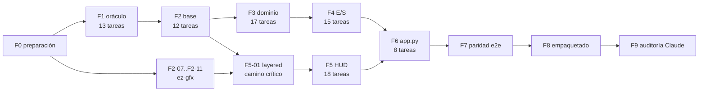

# Plan de migración de EzAgent a Rust

> Estado: propuesta para ejecutar. Fecha: 2026-11-13.
> Ejecutan: **OpenCode + DeepSeek V4.1 Flash** (trabajadores en paralelo).
> Valida y reasigna: **Codex en modo YOLO** (orquestador y revisor, en bucle).
> Auditoría final: **Claude**.
> Fuente de verdad del comportamiento: el código Python en el tag `py-baseline`.

---

## 0. Qué se pide y qué significa «igual»

Clonar EzAgent en Rust: todo el backend, toda la lógica, toda la interfaz
(barra, órbita, vista rápida, menú, ajustes, chat), todas las vistas y todas
las animaciones. La versión Rust tiene que comportarse **exactamente igual**
que la versión Python. Lo que no se puede o no conviene escribir en Rust queda
fuera, como proceso o biblioteca externa (§2).

«Exactamente igual» se mide así; no queda a criterio de nadie:

| Dimensión | Criterio de paridad |
|---|---|
| Textos que ve u oye el usuario, prompts, esquemas de herramientas, salidas de `ezs` | Idénticos byte a byte |
| Lógica pura (normalización, política, selección de herramientas, geometría, easing) | Mismo resultado en todos los casos de los fixtures; flotantes con error relativo ≤ 1e-9 (f64) o ≤ 1e-5 (operaciones que en Python son float32 de numpy) |
| Archivos y bases de datos (`voice.json`, `llm.json`, `tasks.json`, `board.db`, `history.db`, `audit.jsonl`, `latency.jsonl`, historial del chat) | Python lee lo que escribe Rust y Rust lee lo que escribe Python, sin migración. Los JSON se escriben con el mismo formato (sangría, `ensure_ascii`, orden de claves, formato de flotantes) |
| Cuadros del HUD | Ver `parity/thresholds.toml` (§4.4): formas y degradados con diferencia ≤ 1 nivel por canal en el 99,9 % de los píxeles; cuadros con texto con SSIM ≥ 0,995 |
| Animaciones | Mismo cuadro en el mismo instante `t` (mismos umbrales) y mismas curvas numéricas |
| Interacción | Mismos rectángulos de clic (enteros iguales), misma respuesta a la misma secuencia de eventos |
| Flujo de voz de punta a punta | Misma traza normalizada de eventos en los escenarios de reproducción (§4.5) |
| Rendimiento | Igual o mejor que la línea base Python en cada etapa (P50 y P95), cuadros por segundo, CPU en reposo, RAM y arranque |

**Regla de fidelidad.** Si al portar se descubre un error en Python, **no se
corrige**: se reproduce tal cual, se anota en `rust-migration/python-quirks.md`
y se decide después de la auditoría final. Una migración que «mejora» cosas no
se puede verificar.

---

## 1. Línea base del proyecto (medida hoy)

- ~45 800 líneas de Python en `src/ezagent` (sin contar skills de Office).
- 64 archivos de prueba en `tests/` (pytest).
- Archivos grandes que hay que partir: `voice/app.py` (4085), `hud/menu.py`
  (3872), `hud/drop.py` (2246), `hud/layered.py` (1564), `voice/llm.py`
  (1319), `hud/settings.py` (1171), `agent/memory.py` (1102),
  `agent/tools_herdr.py` (1043).
- Interfaz: ventanas *layered* Win32 vía `ctypes` (`UpdateLayeredWindow`), cuadros
  pintados con numpy y Pillow 13.0.0 (FreeType 2.14.3, sin raqm: diseño de texto
  «basic»). Fuentes Geist incluidas. Tk se usa solo como bucle principal
  (`tk.Tk()` en `app.py`).
- Dependencias de terceros en tiempo de ejecución: numpy, Pillow, PyAudio,
  openai, kokoro-onnx (onnxruntime + espeak-ng vía phonemizer), num2words,
  loguru, httpx, python-dotenv, tzdata, pyyaml, send2trash, ddgs,
  beautifulsoup4, lxml, pystray.
- **Hay trabajo sin commit** en `feat/swarm-board`: 92 entradas modificadas o
  borradas y carpetas sin seguimiento, entre ellas **toda `src/ezagent/voice/hud/`**.
  Sin congelar eso primero, el oráculo no existe (tarea F0-01).

---

## 2. Qué queda en Rust y qué queda fuera

### 2.1 Pasa a Rust (todo lo demás)

Orquestación de la app, captura de audio y VAD, Smart Turn, cliente de
whisper, Kokoro (inferencia y cola de voz), LLM y bucle de herramientas,
núcleo agéntico (runtime, política, confirmación, auditoría, herramientas,
memoria, skills, diario, traspasos), Herdr y vigilancia, enjambre completo
(tablero, servicio, servidor, supervisor, incidentes y el comando `ezs`),
chat, HUD completo, bandeja, atajos globales, descargas verificadas,
configuración y empaquetado.

### 2.2 Queda fuera de Rust (servicios externos)

| Servicio | Por qué queda fuera | Cómo se integra desde Rust |
|---|---|---|
| `whisper-server` (whisper.cpp) | Ya es un binario C++ externo, con Vulkan | Igual que hoy: proceso hijo en puerto local, HTTP |
| Herdr (`hc`, `herdr-app`) | Producto externo | Proceso hijo con argumentos en lista |
| CLIs de agentes (Claude Code, OpenCode, Codex, mcode, pi, qwen) | Externos | Igual que hoy, vía Herdr |
| ONNX Runtime | Biblioteca C++; no hay equivalente Rust con la misma salida numérica | Crate `ort` (enlaza la DLL oficial). Misma versión que usa Python, fijada en F0-03 |
| espeak-ng (fonemas de Kokoro) | Biblioteca C; los fonemas tienen que salir idénticos | FFI a la DLL de espeak-ng y sus datos, misma versión que trae `espeakng_loader`; nuevo recurso en `manifest.toml` con SHA256 |
| FreeType | Es el rasterizador que usa Pillow; usar otro cambia los píxeles del texto | `freetype-rs` con FreeType 2.14.3 compilado desde el código fuente |
| Scripts de skills de Office (`default_skills/*/scripts/*.py`: pypdf, reportlab, openpyxl, python-docx) | Son contenido de las skills, no de la app; se ejecutan como hoy | `run_skill_script` busca el intérprete igual que `_python_interpreter`. Si no hay Python, la skill responde que no está disponible (mismo texto que hoy) |
| Evals (promptfoo, Node) | Herramienta de desarrollo | El proveedor de promptfoo llama al binario Rust en modo `eval` (F8-02) |

### 2.3 Decisiones fijadas de antemano

Estas decisiones están tomadas para que los trabajadores no improvisen
arquitectura:

1. **Mismo modelo de hilos que Python.** `std::thread` + `crossbeam-channel` +
   `parking_lot`. **Sin async/tokio**: las llamadas de red van con
   `reqwest::blocking` en hilos de trabajo, como hoy con `httpx` y el SDK de
   OpenAI. Los nombres de hilo se conservan (`ezagent-turn`, `ezagent-speech`,
   `ezagent-models`…).
2. **Tk se reemplaza** por un bucle de mensajes Win32 en el hilo principal con
   una ventana solo de mensajes; la cola `events` se despierta con
   `PostMessage(WM_APP)`; `root.after` pasa a una cola de temporizadores.
3. **El dibujo es puro.** Cada vista tiene un módulo `paint` sin Win32
   (`estado + t → buffer RGBA`) y un módulo `win` delgado. Así el dibujo se
   compara con los cuadros dorados sin abrir ventanas.
4. **`ez-gfx` replica Pillow**, no lo aproxima: `alpha_composite`,
   `ImageDraw` (`ellipse`, `line`, `rounded_rectangle`, `polygon`),
   `resize` con LANCZOS y BICUBIC (porte de `Resample.c` de Pillow),
   `GaussianBlur` (porte de `BoxBlur.c`), `linear_gradient`, y las máscaras SDF
   propias de `menu.py`.
5. **JSON con formato Python.** Un módulo `ez_core::pyjson` emula
   `json.dumps` (separadores, `indent`, `ensure_ascii`, `repr` de flotantes como
   `1e-05`) y se conserva el orden de claves (`serde_json` con
   `preserve_order`, `IndexMap` donde Python usa `dict`).
6. **Python y Rust conviven en la rama** hasta la auditoría: `src/` (Python,
   oráculo) no se toca; Rust vive en `rust/`.

---

## 3. Estructura de la rama

```
rama rust/main  (sale del tag py-baseline)
├── src/ezagent/...            Python, solo lectura (oráculo)
├── tests/                     pytest, solo lectura
├── rust/
│   ├── rust-toolchain.toml    stable fijada, x86_64-pc-windows-msvc
│   ├── Cargo.toml             workspace + [workspace.dependencies] fijadas
│   ├── clippy.toml            too-many-lines-threshold = 60
│   ├── gate.ps1               puerta de calidad por tarea (§5.3)
│   └── crates/
│       ├── ez-core      paths, config, llm_providers, permisos, descargas, pyjson, speech_text, redact, metrics
│       ├── ez-gfx       raster estilo Pillow, texto FreeType, iconos, marca
│       ├── ez-audio     captura, Segmenter, barge-in, Smart Turn, palabra de reactivación
│       ├── ez-stt       proceso whisper-server y cliente, diccionario STT
│       ├── ez-tts       Kokoro (espeak-ng + ort), reproducción, SpeechQueue
│       ├── ez-llm       clientes OpenAI/Anthropic, Messenger, tool_json, tool_markup, contexto, condensador
│       ├── ez-agent     runtime, política, confirmación, auditoría, registro, tools_*, memoria, skills, diario, traspasos
│       ├── ez-herdr     herdr, watcher, tareas, agent_driver/session/prelaunch, actividad
│       ├── ez-swarm     tablero, servicio, servidor, supervisor, incidentes, recuperación + bin `ezs`
│       ├── ez-chat      modelo del chat (sin dibujo)
│       ├── ez-hud       ventanas layered y todas las vistas (paint/ + win/)
│       ├── ez-app       orquestación (app.py partido), bandeja, atajos + bin `ezagent-voice`
│       ├── ez-parity    (dev) lector de fixtures, comparador de imágenes, normalizador de trazas
│       └── ez-fakes     (dev) fake-llm, fake-whisper, fake-hc, fake-agent
├── parity/                    oráculo generado desde Python (§4)
│   ├── gen/  hud/  replay/    generadores (Python)
│   ├── fixtures/  golden/     salidas (solo lectura para los trabajadores)
│   ├── thresholds.toml        umbrales (solo lectura para los trabajadores)
│   └── test-map.csv           cada prueba pytest → su prueba Rust
└── rust-migration/
    ├── AGENTS.rust.md         contrato para trabajadores (§5.1)
    ├── config.toml            comandos de OpenCode/Codex, paralelismo, modelo
    ├── tasks.yaml             estado de todas las tareas (§6.2)
    ├── briefs/  reports/  reviews/
    ├── python-quirks.md       errores de Python reproducidos a propósito
    └── baseline-metrics.json  métricas de la versión Python
```

Correspondencia de módulos (la tarea de andamiaje F0-04 crea **todos** estos
archivos vacíos de antemano, para que las tareas paralelas no se pisen en
`lib.rs` ni en `Cargo.toml`):

| Python | Rust |
|---|---|
| `core/downloads.py`, `core/manifest.toml`, `tts.py` | `ez-core::downloads`, `ez-core::models` |
| `voice/config.py`, `llm_providers.py`, `agent/config.py`, `agent/paths.py` | `ez-core::{config, llm_providers, permissions, paths}` |
| `speech_text.py`, `voice/redact.py`, `voice/metrics.py` | `ez-core::{speech_text, redact, metrics}` |
| `voice/audio.py`, `voice/turn.py`, `voice/wake.py` | `ez-audio::{capture, segmenter, barge_in, turn, wake}` |
| `voice/stt.py`, `voice/stt_dictionary.py` | `ez-stt::{server, client, dictionary}` |
| `voice/tts.py`, `voice/speech_queue.py` | `ez-tts::{phonemes, kokoro, speaker, queue}` |
| `voice/llm.py`, `voice/anthropic_client.py`, `voice/tool_json.py`, `voice/tool_markup.py`, `voice/context.py`, `voice/condenser.py` | `ez-llm::{messenger/*, openai, anthropic, tool_json, tool_markup, context, condenser}` |
| `agent/*.py` | `ez-agent::*` (un módulo por archivo; `tools_herdr` y `memory` partidos en submódulos) |
| `voice/herdr.py`, `watcher.py`, `tasks.py`, `agent_driver.py`, `agent_session.py`, `agent_prelaunch.py`, `activity.py` | `ez-herdr::*` |
| `swarm/*.py` | `ez-swarm::*`, `ez-swarm/src/bin/ezs.rs` |
| `voice/chat/{contexts,markdown,media,session,speech,store,text_input,trace}.py` | `ez-chat::*` |
| `voice/chat/{render,render_base,render_rich}.py`, `voice/hud/*.py`, `voice/brand.py` | `ez-hud::paint::*`, `ez-hud::win::*`, `ez-gfx::{icons,brand}` |
| `voice/app.py`, `tray.py`, `hotkeys.py` | `ez-app::{app/*, tray, hotkeys, main}` |

---

## 4. El oráculo de paridad

Sin oráculo no hay manera de saber si DeepSeek portó bien. Todo se compara
contra salidas generadas **ejecutando el Python de `py-baseline`**, nunca
contra la documentación ni contra lo que «debería» hacer.

### 4.1 Fixtures de lógica (`parity/fixtures/<dominio>/*.jsonl`)

Un generador por dominio en `parity/gen/`. Cada línea:

```json
{"case": "speech_text/0042", "fn": "normalize_for_kokoro", "input": {...}, "output": {...}, "error": null}
```

Reglas del generador: reloj congelado, semilla fija, zona horaria fija,
`HOME`/`APPDATA`/`LOCALAPPDATA` en un directorio temporal, sin red. Correrlo
dos veces debe dar el mismo hash (`parity/regen.ps1 -Check`). Cada fixture
incluye casos normales, límites, vacíos, Unicode (tildes, ñ, emojis,
combinaciones), y los errores con su mensaje exacto.

### 4.2 Pruebas portadas (`parity/test-map.csv`)

Se recolectan todas las pruebas con `pytest --collect-only -q`. Cada una tiene
una fila: `python_test_id, rust_crate, rust_test_path, estado`. Estados
válidos: `portada`, `cubierta_por_fixture:<dominio>`, `no_aplica:<motivo>`
(solo para pruebas de detalles de Python, como importaciones perezosas; Codex
revisa cada `no_aplica`). Al final, el 100 % de las filas tiene que estar en
`portada` o `cubierta_por_fixture`, salvo los `no_aplica` aprobados.

### 4.3 Cuadros dorados del HUD (`parity/golden/hud/`)

`parity/hud/capture.py` llama a las funciones de dibujo puras de Python
(`render_model`, `render_card_body`, `render_fluid`, el dibujo del menú, del
chat, de la vista rápida y de los ajustes) con un catálogo de estados y genera:

- `parity/golden/hud/<vista>/<estado>@<t_ms>.png`
- `parity/golden/hud/<vista>/<estado>.json`: el estado de entrada serializado,
  para que Rust reproduzca exactamente lo mismo.

El catálogo cubre, como mínimo, por cada vista: tema claro y oscuro, tema
personalizado (`theme_accent`), escalas DPI 1,0 / 1,25 / 1,5 / 2,0, forma
esfera y píldora, cada estado de `hud/state.py`, cada posición de anclaje,
silenciado, con y sin actividad en la órbita, cada sección del menú y de los
ajustes con valores largos, foco, hover, campos en edición con selección,
chat vacío, chat con Markdown completo (listas, código, tablas, imágenes,
documentos), confirmaciones y desplazamiento. Cada animación se muestrea en
`t = 0, 16, 33, 50, 100, 200, 400 ms` y en su final.

### 4.4 Umbrales (`parity/thresholds.toml`, solo lectura)

```toml
[pixels.shapes]          # sin texto
max_channel_delta_p999 = 1
max_channel_delta_any  = 3
[pixels.text]            # con texto
ssim_min               = 0.995
max_channel_delta_p995 = 2
[numeric]
f64_rel = 1e-9
f32_rel = 1e-5
[audio.tts]
same_phonemes          = true
length_tolerance_samples = 0
waveform_correlation_min = 0.999
[audio.segmenter]
boundary_tolerance_blocks = 0   # mismo bloque de 30 ms de inicio y fin
[performance]            # Rust / Python, por etapa, P50 y P95
max_ratio = 1.0
```

### 4.5 Reproducción de punta a punta (`parity/replay/`)

- **Falsos de servicio** (crate `ez-fakes`, en Rust porque los usan las dos
  versiones): `fake-llm` (OpenAI y Anthropic con SSE, guion por escenario),
  `fake-whisper` (devuelve la transcripción del guion), `fake-hc` (imita los
  subcomandos de `hc` que usa `voice/herdr.py`, con estado en un archivo) y
  `fake-agent` (pantalla de agente guionizada: trabaja, termina, se bloquea,
  límite de uso, contexto lleno).
- **Arnés Python** `parity/replay/run_py.py`: importa `VoiceApp` y, con
  monkeypatch (sin tocar `src/`), cambia el micrófono por un WAV, el altavoz por
  un registrador y apunta a los falsos. Produce `trace.jsonl`: transiciones de
  estado, eventos del HUD, llamadas a herramientas, frases dichas, archivos
  escritos, líneas de auditoría.
- **Arnés Rust**: feature `replay` de `ez-app` con las mismas costuras.
- **Normalización** (`ez-parity::trace`): quita marcas de tiempo, UUID, puertos
  y rutas temporales; compara el orden causal por hilo.
- **Audios de entrada**: frases generadas con Kokoro más silencio y ruido
  controlado, guardadas en `parity/replay/audio/`.

Escenarios mínimos (cada uno es un archivo YAML):

1. Saludo y respuesta sin herramientas.
2. Pregunta de hora (herramienta local + acuse).
3. Atajos locales: silenciar, reactivar, colgar, repetir, «Ok, gracias. Mutéate».
4. Frase partida en dos (unión de frases dentro de 3 s).
5. Barge-in mientras habla.
6. Eco durante el TTS descartado.
7. Delegar a OpenCode, vigilar y aviso al terminar.
8. Cadena planificador → desarrollador con traspaso.
9. Agente bloqueado que pide confirmación.
10. Operación destructiva con confirmación por voz (aceptar y rechazar).
11. `taint`: lectura web y luego escritura que pide confirmación.
12. Memoria: recordar, recuperar, olvidar, compactar.
13. Skill con script (con y sin Python disponible).
14. Errores del LLM: 401, 404, 413, 429, desconexión y tiempo agotado.
15. Proveedor estilo Anthropic con herramientas.
16. Tope de rondas de herramientas y de llamadas por turno.
17. Modelo que escribe el marcado de herramienta como texto (`tool_markup`).
18. Enjambre: plan → dev ∥ front → qa → fix → cierre, con `ezs`.
19. Enjambre: incidente de límite de uso y retoma a la hora indicada.
20. Enjambre: contexto lleno, ventana cerrada y programa que sale.
21. Chat escrito: mensaje, Markdown, historial, borrar del historial.
22. Pausa y palabra de reactivación.
23. Cambio de ajustes desde el menú (voz, proveedor, atajos) y guardado.
24. Cambio de modelo con `fetch_models` y `match_model`.
25. Arranque sin whisper, sin modelo de Kokoro y sin Smart Turn (degradación).

---

## 5. Reglas para los trabajadores

### 5.1 `rust-migration/AGENTS.rust.md` (lo crea F0-02)

Todo brief empieza con: **«Excepción a AGENTS.md: rama de migración a Rust;
aplica `rust-migration/AGENTS.rust.md`.»** Contenido obligatorio:

1. **Una tarea por sesión, solo los archivos del brief.** Los archivos de
   `src/`, `tests/`, `parity/fixtures/`, `parity/golden/`,
   `parity/thresholds.toml` y `rust-migration/tasks.yaml` son de solo lectura.
2. **Lee primero el Python de `py-baseline`** que indica el brief, completo, y
   los fixtures de su dominio. El Python es la especificación.
3. **Porta todo**: cada función pública, cada rama, cada valor por defecto,
   cada texto, cada mensaje de error. Nada de `todo!()`, `unimplemented!()`,
   `// TODO`, `#[ignore]` ni pruebas comentadas.
4. **Textos copiados literalmente** del Python, en español neutro
   latinoamericano. No se reescribe ningún texto.
5. **Límites:** módulos ≤ 600 líneas, funciones ≤ 60 (salvo tablas de datos),
   diff ≤ ~300 líneas por paso; `cargo test` al terminar cada paso.
6. **Seguridad:** nada de `cmd /c`, `powershell -Command` con texto
   interpolado ni ningún shell; `std::process::Command` solo con los binarios
   declarados y argumentos en lista. Borrar solo en directorios temporales
   propios; lo del usuario va a la Papelera (`trash`). `unsafe` solo en
   `ez-hud::win`, `ez-audio::capture`, `ez-tts::phonemes`, `ez-app::{tray,hotkeys}`,
   cada bloque con comentario `// SAFETY:`. Claves de API nunca en logs. El
   servidor del enjambre solo escucha en `127.0.0.1` y exige token.
7. **Logs** con `tracing`; nada de `println!` salvo la salida de `ezs` y de las
   opciones de línea de comandos que hoy imprimen.
8. **Nada bloquea** el hilo de UI ni los de audio. Estado compartido con lock o
   canal.
9. **Dependencias:** solo las de `[workspace.dependencies]`. Si hace falta otra,
   detente y explícalo en el informe.
10. **Si algo no está especificado:** opción más simple y segura, comentario
    `// DECISION: <motivo>` y mención en el informe.
11. **Informe final** con el formato de AGENTS.md §6, en
    `rust-migration/reports/<ID>-r<ronda>.md`, más la lista de fixtures y
    pruebas portadas.

**Trampas de Python a Rust** (la sección más importante del archivo):

| Python | Rust correcto |
|---|---|
| `round(x)` redondea a par (2.5 → 2) | `f64::round_ties_even`, nunca `round` |
| `int(x)` trunca; `//` y `%` usan piso (también con negativos) | `trunc`, `div_euclid`/`rem_euclid` o `floor` explícito según el caso |
| `len(s)`, cortes `s[:280]` cuentan puntos de código | `chars().count()`, cortar por `char_indices`, nunca por bytes |
| `str.lower()`, `casefold()`, `unicodedata.normalize` | `to_lowercase()` (verificar con fixtures), `unicode-normalization` |
| `re` admite lookahead/lookbehind y referencias | `regex`; si el patrón las usa, `fancy-regex`. Cada regex con su fixture |
| `dict` conserva el orden de inserción | `IndexMap` |
| `json.dumps` (`", "`, `": "`, `ensure_ascii=True` por defecto, `1e-05`) | `ez_core::pyjson` |
| `datetime.isoformat()`, `time.time()` | `ez_core::pytime` (mismo formato, misma precisión) |
| numpy hace la mayoría de cuentas en float32 cuando el array es float32 | Usar `f32` donde el array Python es `float32`; `f64` donde es `float64` |
| `sorted(key=...)` es estable | `sort_by` (estable); con flotantes, `total_cmp` |
| Excepciones que el Python atrapa y convierte en texto | `Result` + el mismo texto final |

### 5.2 Brief por tarea (`rust-migration/briefs/<ID>.md`)

```markdown
# <ID> — <título>
Excepción a AGENTS.md: rama de migración a Rust; aplica rust-migration/AGENTS.rust.md.

## Fuente Python (especificación, en py-baseline)
- src/ezagent/... líneas A–B
## Archivos que se tocan
- rust/crates/<crate>/src/<módulo>.rs
- rust/crates/<crate>/tests/<prueba>.rs
## Fixtures y pruebas
- parity/fixtures/<dominio>/*.jsonl (deben consumirse TODOS los casos)
- Filas de parity/test-map.csv: <lista>
## Interfaz pública esperada
- <firmas de F2/F0-04 que hay que respetar>
## Criterios de aceptación
- gate.ps1 -Task <ID> en verde
- <criterios específicos de la tabla de tareas>
## Rondas anteriores
- (Codex añade aquí los hallazgos de cada rechazo)
```

### 5.3 Puerta automática (`rust/gate.ps1 -Task <ID>`)

En orden; el primer fallo detiene:

1. **Alcance:** `git diff --name-only rust/main...HEAD` ⊆ archivos del brief.
2. `cargo fmt --check`.
3. `cargo clippy --workspace --all-targets -- -D warnings` (incluye
   `too_many_lines` = 60).
4. `cargo test -p <crates de la tarea>` y luego `cargo test --workspace`.
5. **Cobertura de fixtures:** cada prueba de paridad afirma que leyó el número
   de casos del archivo (`assert_eq!(cases_run, cases_in_file)`).
6. **Patrones prohibidos** (búsqueda en el diff): `todo!`, `unimplemented!`,
   `#[ignore]`, `TODO`, `"cmd"`, `"/c"`, `-Command`, `remove_dir_all` fuera de
   temporales, `unsafe` fuera de los módulos permitidos o sin `// SAFETY:`,
   `println!` fuera de los permitidos, `.unwrap()` en código no de prueba sin
   comentario que lo justifique.
7. **Tamaños:** ningún `.rs` > 600 líneas.
8. **Paridad Python intacta:** `uv run pytest -q` sigue en verde (nadie tocó
   `src/`).

---

## 6. El bucle de ejecución y validación

### 6.1 Papeles

- **Codex (YOLO) = orquestador y revisor.** Lee `tasks.yaml`, escribe los
  briefs, lanza trabajadores, corre la puerta, revisa el diff contra el Python,
  acepta o rechaza, fusiona y replanifica. **No escribe código de producto**;
  solo puede tocar infraestructura (`gate.ps1`, `tasks.yaml`, briefs, reviews)
  y resolver conflictos triviales de fusión.
- **OpenCode + DeepSeek V4.1 Flash = trabajadores.** Una tarea cada uno, cada
  uno en su worktree.
- **Claude = auditor final** (fase F9) y escalamiento para tareas bloqueadas.

### 6.2 Estado (`rust-migration/tasks.yaml`)

```yaml
- id: F3-07
  title: tools_core y tools_fs
  phase: F3
  depends_on: [F2-04, F3-04]
  status: todo        # todo | in_progress | review | rejected | done | split | needs_owner
  round: 0
  worker: null        # id de sesión de OpenCode
  worktree: null
  python: [src/ezagent/agent/tools_core.py, src/ezagent/agent/tools_fs.py]
  files: [rust/crates/ez-agent/src/tools_core.rs, rust/crates/ez-agent/src/tools_fs.rs, rust/crates/ez-agent/tests/tools_fs.rs]
  fixtures: [tools_fs]
  tests: [tests/test_audit_tools.py, tests/test_runtime_security.py::*fs*]
```

### 6.3 Comandos (`rust-migration/config.toml`)

Los flags exactos de los CLIs **no se fijan en este plan**: F0-02 los
verifica con `--help` en la máquina y los deja aquí.

```toml
max_parallel_workers = 6          # subir a 10 en F3 y F5 si el proveedor lo aguanta
worker_model = "deepseek/deepseek-v4.1-flash"   # id exacto: verificar en OpenCode
worker_cmd = ["opencode", "run", "--model", "{model}", "{prompt}"]   # verificar
validator_cmd = ["codex", "exec", "--yolo", "{prompt}"]               # verificar
worktree_root = "../EzAgent-wt"
max_rounds_before_split = 3
max_rounds_before_escalation = 5
```

### 6.4 Ciclo de Codex

```
repetir hasta que todas las tareas estén en done:
  1. Sincroniza tasks.yaml con rust/main.
  2. Elige tareas listas (dependencias en done; estado todo o rejected),
     hasta llenar max_parallel_workers. Prioriza el camino crítico (§8).
  3. Por cada una:
       git worktree add ../EzAgent-wt/<ID> -b rust/task/<ID> rust/main
       escribe/actualiza briefs/<ID>.md, estado in_progress, lanza worker_cmd
       con el prompt de §6.5.
  4. Cuando un trabajador termina: estado review.
       a. gate.ps1 -Task <ID>.
       b. Revisión humana-equivalente (§6.6) contra el Python.
       c. Escribe reviews/<ID>-r<n>.md con veredicto ACEPTA o RECHAZA y
          hallazgos concretos (archivo, línea, caso de fixture, diferencia).
  5. ACEPTA: rebase sobre rust/main, gate completo otra vez, merge --no-ff,
     cargo test --workspace. Si algo se rompe tras fusionar: revierte la
     fusión y reabre la tarea con el fallo. Las fusiones van de una en una.
  6. RECHAZA: estado rejected, round += 1, añade los hallazgos a
     "Rondas anteriores" del brief y relanza (sesión nueva, mismo worktree).
       - Ronda 2: el brief agrega las líneas exactas del Python y el diff del
         caso que falla.
       - Ronda 3 (max_rounds_before_split): divide la tarea en subtareas
         <ID>.a, <ID>.b… más pequeñas; estado split.
       - Ronda 5: estado needs_owner y se escala a Claude con el historial.
  7. Al cerrar todas las tareas de una fase: corre la puerta de fase (§7)
     y no abre la fase siguiente hasta pasarla, salvo tareas cuyas
     dependencias ya estén cumplidas (las fases se solapan por dependencias,
     no por calendario).
```

### 6.5 Prompt del trabajador

```
Trabajas en el worktree <ruta>, rama rust/task/<ID>. Lee, en este orden:
rust-migration/AGENTS.rust.md, rust-migration/briefs/<ID>.md, el código Python
indicado (completo) y los fixtures de tu dominio. Porta el comportamiento a
Rust en los archivos del brief y nada más. Ejecuta rust/gate.ps1 -Task <ID>
hasta que pase. No modifiques fixtures, golden, umbrales ni código Python.
Termina con el informe en rust-migration/reports/<ID>-r<ronda>.md.
```

### 6.6 Revisión de Codex (además de la puerta)

1. Abre el Python y el Rust lado a lado: ¿están todas las funciones, ramas,
   valores por defecto y textos?
2. ¿Algún caso de fixture se «arregló» con un `if` especial en vez de portar
   la lógica?
3. ¿Las firmas públicas coinciden con lo que esperan las tareas dependientes?
4. ¿Hay alguna trampa de §5.1 (redondeo, índices de bytes, regex, orden de
   claves)?
5. ¿Concurrencia: locks, canales, nombres de hilo, nada bloquea UI ni audio?
6. ¿Seguridad (§5.1 punto 6)?
7. ¿El informe declara todas las `// DECISION`? ¿Son razonables?

---

## 7. Fases, tareas y criterios de validación

Columnas: **Py** = fuente Python (especificación); **Dep** = dependencias;
**Validación** = criterio adicional a la puerta automática. Las tareas de una
misma ola sin dependencias entre sí corren en paralelo.

### F0 — Preparación (secuencial; Codex, con aprobación del usuario en F0-01)

| ID | Qué | Validación |
|---|---|---|
| F0-01 | Congelar la línea base: commit del trabajo en curso de `feat/swarm-board` (incluida `voice/hud/` y los archivos sin seguimiento), `uv run pytest -q` y ruff en verde, tag `py-baseline`. **Lo aprueba el usuario** | Tag existe; `git status` limpio; pytest verde |
| F0-02 | Rama `rust/main` desde `py-baseline`; carpeta `rust-migration/` con `AGENTS.rust.md`, `config.toml` (flags verificados con `--help`), plantillas y `tasks.yaml` con todas las tareas de este plan | `tasks.yaml` valida contra el esquema; cada tarea tiene `python`, `files` y `depends_on` |
| F0-03 | Toolchain y dependencias: `rust-toolchain.toml`, workspace, `[workspace.dependencies]` con versión exacta de cada crate (`windows`, `cpal`, `ort`, `reqwest` blocking+rustls, `serde`, `serde_json` preserve_order, `indexmap`, `toml`, `rusqlite` bundled con FTS5, `tiny_http`, `crossbeam-channel`, `parking_lot`, `tracing`, `tracing-subscriber`, `tracing-appender`, `freetype-rs`, `image` (PNG), `sha2`, `zip`, `trash`, `scraper`, `regex`, `fancy-regex`, `unicode-normalization`, `chrono`, `chrono-tz`, `uuid`, `dotenvy`, `serde_yaml`, `ndarray` solo si hace falta). Versión de ONNX Runtime igual a la de Python | `cargo build --workspace` en verde; `rusqlite` con FTS5 comprobado por una prueba |
| F0-04 | Andamiaje: todos los crates y **todos** los módulos de §3 creados vacíos, con `mod` declarados; `ez-parity` y `ez-fakes` vacíos | `cargo build` verde; ningún trabajador necesitará tocar `lib.rs` ni `Cargo.toml` |
| F0-05 | `rust/gate.ps1` completo (§5.3) y su prueba con un diff de ejemplo que viola cada regla | Cada regla rechaza su caso de ejemplo |
| F0-06 | Métricas base de Python en `baseline-metrics.json`: latencias de `latency.jsonl` (P50/P95 por etapa), `frame_stats` por ventana, CPU en reposo, RAM, tiempo de arranque, lista de dispositivos de PyAudio | Archivo con todas las métricas y cómo se midieron |

**Puerta F0:** rama creada, gate probado, base congelada.

### F1 — Oráculo de paridad (Python y falsos; ola ancha, 13 tareas)

| ID | Py | Qué genera | Dep | Validación |
|---|---|---|---|---|
| F1-01 | — | Marco: `parity/gen/_common.py` (reloj, semilla, perfil temporal), formato JSONL, `regen.ps1 -Check`, `ez-parity` (lector JSONL, comparador de PNG con SSIM y deltas, normalizador de trazas) | F0 | Dos corridas → mismo hash |
| F1-02 | `speech_text`, `redact`, `stt_dictionary`, `tool_json`, `tool_markup`, `condenser`, `handoff`, `handoff_packet`, `chat/markdown`, `chat/speech`, `chat/text_input`, `chat/trace`; de `app.py`: `_Sentences`, `_strip_courtesy`, `_is_filler_sentence`, `_hotkey_key`, `_fast_command` | Fixtures de texto (≥ 1500 casos en total; ≥ 300 de `speech_text`: números, dinero, horas, siglas, URLs) | F1-01 | Cada función pública con ≥ 20 casos, incluidos errores |
| F1-03 | `voice/config`, `llm_providers`, `agent/config`, `agent/paths`, `agent/policy`, `tools_d` | Carga, normalización, valores por defecto y guardado (archivo resultante byte a byte); matriz de política; `match_model` | F1-01 | Round-trip y cada campo de `VoiceConfig` cubierto |
| F1-04 | `system_prompt`, `runtime.select_tool_names`/`tools_for`, `registry`, `confirm`, `audit`, `orchestration`, `skills` | Prompt completo por combinación de agentes y skills; esquemas de herramientas tal como se envían; textos de confirmación; líneas de auditoría | F1-01 | Prompt byte a byte |
| F1-05 | `voice/llm.py`, `anthropic_client.py` | Cuerpos de petición exactos por turno (OpenAI y Anthropic), parseo de SSE, `friendly_llm_error`, recuperación de JSON roto, compactación de contexto | F1-01, F1-11 | Capturados en `fake-llm` |
| F1-06 | `swarm/*` | Transcripciones de comandos `ezs` (entrada → salida → volcado de `board.db`), textos de `protocol`, salud de `view`, `progress`, clasificación de `incidents`, decisiones de `recovery` | F1-01 | Volcado SQL normalizado |
| F1-07 | `memory`, `journal`, `chat/store`, `chat/session`, `chat/contexts`, `tasks`, `activity`, `metrics` | Secuencias de operaciones → volcado de archivos y BD | F1-01 | FTS5 y respaldo LIKE cubiertos |
| F1-08 | `audio`, `turn`, `wake` | WAV de prueba (voz Kokoro + silencio + ruido) → segmentos, barge-in, `pcm_rms`, remuestreo; log-mel y probabilidad de Smart Turn; detección de la frase de reactivación | F1-01 | ≥ 40 WAV con límites marcados |
| F1-09 | `voice/tts.py`, `tts.py`, `kokoro_onnx` | Corpus de 60 frases: texto normalizado, fonemas, tokens, estilo de voz (incluidas mezclas `a+b`), PCM de salida | F1-01 | Fonemas y PCM guardados |
| F1-10a | `hud/drop`, `flow`, `marks`, `state`, `brand`, `icons`, `bar_motion`, `anim` | Cuadros dorados de la barra, la Marea, la órbita y los botones; curvas de animación | F1-01 | Catálogo §4.3 completo para estas vistas |
| F1-10b | `hud/menu`, `menu_layout`, `settings`, `settings_window`, `hotkey_field` | Cuadros del menú y de los ajustes; `MenuHit` para una rejilla de puntos; secuencias de puntero, rueda, sliders y edición | F1-01 | Cada sección y control |
| F1-10c | `chat/render*`, `hud/chat_*`, `peek`, `peek_paint`, `tokens`, `bar_theme`, `theme_accent`, `a11y`, `layered` (`frame_due`, `paint_due`, `wait_delay`, `paint_mark`) | Cuadros del chat, de la vista rápida y de la tarjeta; paletas; ritmo de cuadros | F1-01 | Markdown completo y morph esfera/píldora → panel |
| F1-11 | `voice/herdr.py` (inventario de subcomandos de `hc`) | Crate `ez-fakes`: `fake-llm`, `fake-whisper`, `fake-hc`, `fake-agent` | F0-04 | La app Python corre contra los falsos sin cambios en `src/` |
| F1-12 | `voice/app.py` | `parity/replay/run_py.py` + los 25 escenarios de §4.5 → trazas doradas | F1-11 | Cada escenario determinista (dos corridas iguales) |
| F1-13 | `tests/` | `parity/test-map.csv` completo | F1-01 | Todas las pruebas recolectadas aparecen |

**Puerta F1:** `regen.ps1 -Check` estable; catálogo HUD y escenarios
completos; Codex revisa que cada módulo Python tenga dominio de fixtures.

### F2 — Base compartida (Rust; ola de 12 tareas)

| ID | Py | Rust | Dep | Validación |
|---|---|---|---|---|
| F2-01 | rutas en `config.py`, `paths.py`, `audit.py` (formato) | `ez-core::{dirs, pyjson, pytime, logging}` | F0, F1-01 | Fixtures de `json.dumps` con todas las combinaciones usadas en el código; `latency.jsonl` y `audit.jsonl` con mismo formato |
| F2-02 | `voice/config.py` | `ez-core::config` | F2-01, F1-03 | Fixtures de config; Python carga el `voice.json` que escribe Rust |
| F2-03 | `llm_providers.py` | `ez-core::llm_providers` | F2-01, F1-03 | Presets, perfiles, `match_model` |
| F2-04 | `agent/config.py`, `agent/paths.py`, `agent/policy.py` | `ez-core::{permissions, paths}`, `ez-agent::policy` | F2-01, F1-03 | Matriz de política completa |
| F2-05 | `core/downloads.py`, `tts.py`, `manifest.toml` | `ez-core::{downloads, models}` + recurso espeak-ng en el manifiesto | F2-01 | SHA256, `strip_prefix`, opcionales; nunca instala sin hash correcto |
| F2-06 | `speech_text.py`, `voice/redact.py`, `stt_dictionary.py` | `ez-core::{speech_text, redact}`, `ez-stt::dictionary` | F2-01, F1-02 | Incluye porte de `num2words` en español solo para las formas que se usan |
| F2-07 | usos de `Image.new/fromarray/alpha_composite/linear_gradient` y numpy | `ez-gfx::{raster, composite}` | F0, F1-01 | Fórmula de `alpha_composite` de Pillow exacta (pruebas propias contra Pillow generadas en F1-10a) |
| F2-08 | `menu.py` 382–699 (SDF), `ImageDraw` | `ez-gfx::{sdf, draw}` | F2-07 | Formas sueltas contra Pillow, delta ≤ 1 |
| F2-09 | `resize` LANCZOS/BICUBIC, `GaussianBlur` | `ez-gfx::{resample, blur}` (porte de `Resample.c` y `BoxBlur.c` de Pillow 13.0.0) | F2-07 | Delta ≤ 1 contra Pillow |
| F2-10 | `hud/text.py`, `render_base.py` (fuentes) | `ez-gfx::text` (FreeType 2.14.3, diseño basic como Pillow sin raqm, `getbbox`, `getlength`, ajuste) | F2-07 | Glifos y cadenas contra Pillow en 4 tamaños y 6 fuentes Geist |
| F2-11 | `hud/icons.py`, `voice/brand.py` | `ez-gfx::{icons, brand}` | F2-08, F2-09 | Cada icono en cada tamaño |
| F2-12 | `tokens`, `bar_theme`, `theme_accent`, `a11y`, `anim`, `bar_motion`, `chat_geometry`, `menu_layout`, `frame_due`…`paint_mark` de `layered.py` | `ez-hud::{tokens, theme, anim, motion, geometry, layout, pacing}` | F2-01, F1-10* | Fixtures numéricos 1e-9 |

**Puerta F2:** `ez-gfx` reproduce las primitivas de Pillow dentro de umbral;
config y JSON con formato Python verificados en ambos sentidos.

### F3 — Lógica de dominio (Rust; ola de 17 tareas)

| ID | Py | Rust | Dep | Validación |
|---|---|---|---|---|
| F3-01 | `tool_json`, `tool_markup`, `condenser`, `context` | `ez-llm::*` | F2-01 | Fixtures F1-02/F1-05 |
| F3-02 | `handoff`, `handoff_packet`, `orchestration` | `ez-agent::*` | F2-01 | Fixtures |
| F3-03 | `registry.py` | `ez-agent::registry` (validación, timeout de ejecución) | F2-04 | Esquemas byte a byte |
| F3-04 | `confirm.py`, `audit.py`, `journal.py` | `ez-agent::*` | F2-01, F2-04 | Textos de confirmación generados por código; auditoría redacta claves |
| F3-05 | `system_prompt.py`, `agent_guides/*`, `default_skills/*` (incrustados) | `ez-agent::system_prompt` | F3-03 | Prompt byte a byte; recarga en caliente de `system.md` |
| F3-06 | `skills.py`, `tools_skills.py` | `ez-agent::{skills, tools_skills}` | F3-03 | Frontmatter YAML; búsqueda de intérprete idéntica |
| F3-07 | `tools_core.py`, `tools_fs.py` | `ez-agent::*` | F3-03, F3-04 | Papelera, diario deshacible, `taint` |
| F3-08 | `tools_d.py` | `ez-agent::tools_d` | F3-03 | Herramientas declarativas de prueba |
| F3-09a | `memory.py` 1–562 (esquema, conexión, FTS5) | `ez-agent::memory::{schema, store}` | F2-01 | Abre un `history.db` creado por Python |
| F3-09b | `memory.py` 563–1102, `tools_memory.py` | `ez-agent::memory::{ops, recall}`, `tools_memory` | F3-09a | Fixtures F1-07; FTS5 y LIKE |
| F3-10 | `search.py`, `tools_web.py` | `ez-agent::{search, tools_web}`: porte del motor que usa `search.py` con `ddgs`, extracción de texto con `scraper` | F3-03 | Parseo sobre HTML guardado (fixtures); prueba de humo en vivo opcional. **Riesgo** (§9) |
| F3-11 | `swarm/models`, `protocol`, `db`, `incident_db`, `mail` | `ez-swarm::*` | F2-01 | Esquema SQL idéntico; textos byte a byte |
| F3-12 | `swarm/store`, `service`, `view`, `progress`, `incidents` | `ez-swarm::*` | F3-11 | Transcripciones F1-06 |
| F3-13 | `swarm/server`, `cli` | `ez-swarm::server` (`tiny_http`, solo `127.0.0.1`, token) + bin `ezs` | F3-12 | Salida de `ezs` byte a byte; `ezs` Python ↔ servidor Rust y al revés |
| F3-14 | `voice/chat/{contexts,markdown,media,session,speech,store,text_input,trace}` | `ez-chat::*` | F2-01 | Historial JSONL compatible en ambos sentidos |
| F3-15 | `tasks.py`, `activity.py`, `metrics.py` | `ez-herdr::{tasks, activity}`, `ez-core::metrics` | F2-01 | `tasks.json` compatible; resumen cada diez turnos |
| F3-16 | `wake.py`; de `app.py`: `_fast_command`, `_strip_courtesy`, `_Sentences`, `_is_filler_sentence`, `_hotkey_key` | `ez-audio::wake`, `ez-app::fast`, `ez-app::sentences` | F2-06 | Fixtures F1-02 |

### F4 — E/S y servicios (Rust; ola de 15 tareas)

| ID | Py | Rust | Dep | Validación |
|---|---|---|---|---|
| F4-01 | `audio.py` | `ez-audio::{capture (cpal/WASAPI), segmenter, barge_in, resample}` | F2-01 | Segmenter sobre los WAV de F1-08 con tolerancia 0 bloques; el micrófono guardado en `voice.json` se resuelve igual que con PyAudio (tabla de equivalencias con la lista de F0-06) |
| F4-02 | `turn.py` | `ez-audio::turn` (log-mel con numpy portado + `ort`, hilo `ezagent-turn`) | F4-01 | Log-mel 1e-5; probabilidad 1e-4; no bloquea el hilo de audio |
| F4-03 | `stt.py`, `ensure_whisper` y ayudantes de `app.py` 285–383 | `ez-stt::{server, client}` | F2-02 | Mismo WAV enviado (bytes); elección Vulkan/CPU; puerto libre; precalentado |
| F4-04 | `kokoro_onnx` (fonemizador, tokens, inferencia), `voice/tts.py` | `ez-tts::{phonemes (FFI espeak-ng), kokoro (ort), voices}` | F2-05, F2-06 | Fonemas idénticos; PCM con correlación ≥ 0,999 y misma longitud |
| F4-05 | `speech_queue.py`, reproducción de `voice/tts.py` | `ez-tts::{speaker, queue}` | F4-04, F4-01 | Dos hilos y dos locks como en Python; barge-in corta |
| F4-06 | SDK OpenAI (lo que usa `llm.py`), `anthropic_client.py` | `ez-llm::{openai, anthropic, sse, errors}` | F2-03 | Peticiones byte a byte en `fake-llm`; sin reintentos automáticos; `friendly_llm_error` |
| F4-07 | `llm.py` 1–489 y 1064–1283 | `ez-llm::messenger::{request, history, recovery}` | F4-06, F3-01, F3-05 | Cuerpos de petición F1-05 |
| F4-08 | `llm.py` 490–1063 | `ez-llm::messenger::tool_loop` (rondas, cierre sin herramientas, acuse, cancelación, tiempo agotado) | F4-07 | Escenarios 2, 14–17 a nivel de módulo |
| F4-09 | `llm.py` 1283–1319, `runtime.py` | `ez-llm::messenger::notices`, `ez-agent::runtime` | F4-08, F3-02…F3-08 | `begin_turn` solo reconstruye herramientas si cambian permisos o skills |
| F4-10 | `herdr.py`, `watcher.py`, `agent_prelaunch.py` | `ez-herdr::{herdr, watcher, prelaunch}` | F3-15, F1-11 | Contra `fake-hc`: mismos argumentos (lista) por operación |
| F4-11 | `agent_driver.py`, `agent_session.py` | `ez-herdr::{driver, session}` | F4-10 | Comandos por perfil, modelo y esfuerzo validados; guía de cua-driver con `gui=true` |
| F4-12a | `tools_herdr.py` 1–595 | `ez-agent::tools_herdr::{args, summaries}` | F4-11 | Fixtures |
| F4-12b | `tools_herdr.py` 596–1043 | `ez-agent::tools_herdr::{delegate, voice, builder}` | F4-12a | Cadenas `input_from`/`then`; vigilancia por defecto |
| F4-13a | `swarm/supervisor.py`, `stack.py` | `ez-swarm::{supervisor, stack}` | F3-13, F4-10 | Abre cada miembro cuando le toca; `EZS_SEAT`; argumentos por harness |
| F4-13b | `swarm/recovery.py`, `tools_swarm.py` | `ez-swarm::recovery`, `ez-agent::tools_swarm` | F4-13a | Escenarios 18–20 a nivel de módulo |

### F5 — HUD (Rust; ola de 18 tareas; el camino crítico es F5-01)

| ID | Py | Rust | Dep | Validación |
|---|---|---|---|---|
| F5-01 | `layered.py` (todo salvo lo puro de F2-12) | `ez-hud::win::{layered, wndproc, dpi, monitor, keyboard, pointer, drag, wheel, frame_stats}` | F2-12 | Ventana de prueba a 30 fps activo; `UpdateLayeredWindow` con DIB premultiplicado; lectura del registro de la rueda; arrastre; DPI por monitor |
| F5-02 | `state.py`, `flow.py`, `marks.py` | `ez-hud::paint::{state, flow, marks}` | F2-12, F2-07 | Cuadros dorados F1-10a |
| F5-03 | `drop.py` 62–552 (geometría y `DropModel`) | `ez-hud::model::drop` | F2-12 | `clean_dock`, `emerge_order`, `slots`, `choose_dock` (incluye `test_bar_dock`) |
| F5-04 | `drop.py` 553–844 (dibujo) | `ez-hud::paint::drop` | F5-02, F5-03, F2-11 | Cuadros dorados de la barra y la tarjeta |
| F5-05 | `drop.py` 845–2246 (`DropWindow`, `CardWindow`, `DropUI`) | `ez-hud::win::drop::*` (partido en ≤ 600 líneas) | F5-01, F5-04 | Secuencias de eventos → mismos estados; tema del sistema |
| F5-06 | `peek.py`, `peek_paint.py` | `ez-hud::{paint, win}::peek` | F5-01, F5-02 | Cuadros dorados y nacimiento desde la forma |
| F5-07 | `menu.py` 699–1342 | `ez-hud::model::menu::{geometry, clock, external}` | F2-08, F2-12, F5-11 | Fixtures de apertura y cierre |
| F5-08 | `menu.py` 1343–1887 | `ez-hud::model::menu::{selectors, rects, hit, pointer}` | F5-07 | `MenuHit` idéntico en toda la rejilla |
| F5-09 | `menu.py` 1888–2338 | `ez-hud::model::menu::{sliders, wheel, edit, voice_test}` | F5-08 | Secuencias de F1-10b |
| F5-10a | `menu.py` 2339–3100 | `ez-hud::paint::menu::*` (primera mitad del dibujo) | F5-07, F2-10, F2-11 | Cuadros dorados de las secciones asignadas |
| F5-10b | `menu.py` 3101–3872 | `ez-hud::paint::menu::*` (segunda mitad) | F5-10a | Ídem. Codex fija el corte exacto en una frontera de método al escribir el brief |
| F5-11 | `settings.py` | `ez-hud::model::settings` | F2-02, F2-03 | Normalización, edición, guardado y selectores |
| F5-12 | `settings_window.py`, `hotkey_field.py` | `ez-hud::{paint, win}::settings_window`, `hotkey_field` | F5-01, F5-11, F2-10 | Cinco secciones; mover y redimensionar; captura de atajos en vivo; campo secreto |
| F5-13 | `chat/render_base.py`, `render.py`, `render_rich.py`, `hud/chat_labels.py` | `ez-hud::paint::chat::render*` | F2-10, F3-14 | Markdown completo, tablas, imágenes, tarjetas de documento |
| F5-14 | `chat_view.py`, `chat_header.py`, `chat_footer.py` | `ez-hud::{model,paint}::chat::*` | F5-13 | Scroll, entrada multilínea, confirmaciones, historial, fundido al borrar, copiar |
| F5-15 | `chat_paint.py`, `chat_ui.py` | `ez-hud::{paint,win}::chat::{compose, window}` | F5-14, F5-01 | Morph esfera/píldora → panel, cuadro a cuadro |
| F5-16 | `tray.py`, `hotkeys.py` | `ez-app::{tray, hotkeys}` (Win32 directo) | F0-04 | Mismo menú de bandeja; mismos atajos y alias; conflicto de atajo → mismo respaldo |

### F6 — Orquestación (`app.py` partido; ola de 8 tareas)

Antes de F6-01, Codex genera `rust-migration/app-inventory.md`: cada método de
`VoiceApp` con su línea, la tarea Rust que lo recibe y cada uso de
`self.root` (Tk). Ningún método puede quedar sin tarea.

| ID | Py (`voice/app.py`) | Rust (`ez-app::app::*`) | Dep | Validación |
|---|---|---|---|---|
| F6-01 | 384–699, 927–1125 (estado, arranque) | `core`, `startup`, bucle Win32 + cola de eventos + temporizadores | F4-03, F4-05, F4-09, F5-05 | La app arranca, carga config y servicios en el mismo orden (traza de arranque) |
| F6-02 | 700–926 (bandeja) | `tray_wiring` | F6-01, F5-16 | Acciones del menú de bandeja |
| F6-03 | 1126–1673 (eventos y llamada) | `events`, `call` | F6-01 | Escenarios 1, 3, 4, 5, 6 |
| F6-04 | 1674–2013 (estados y workers) | `states`, `workers` | F6-03 | Escenarios 2, 14–17; primera cláusula corta |
| F6-05 | 2014–2450 (chat y watcher) | `chat`, `watch` | F6-04, F5-15, F4-10 | Escenarios 7–9, 21 |
| F6-06a | 2451–2657 (atajos y ajustes) | `settings_apply` | F6-01, F5-11 | Escenarios 23, 24 |
| F6-06b | 2658–3396 (menú embebido) | `menu_wiring` | F6-06a, F5-10b | Cada acción del menú |
| F6-07 | 3397–3986 (pausa, reactivación, actividad, `run_demo`) y 3987–4085 (`main`, opciones `--write-config`, mics, agentes) | `pause`, `activity`, `demo`, `main` | F6-05 | Escenario 22; salida de las opciones de línea de comandos byte a byte |

### F7 — Integración y paridad de punta a punta (Codex dirige; trabajadores corrigen)

| ID | Qué | Validación |
|---|---|---|
| F7-01 | Feature `replay` en Rust y corrida de los 25 escenarios | 25/25 trazas iguales a las doradas |
| F7-02 | Barrido completo de cuadros dorados del HUD y secuencias de interacción | 100 % dentro de `thresholds.toml` |
| F7-03 | Compatibilidad de datos: perfil real anonimizado (copia de `%APPDATA%\EzAgent`) leído por Rust; lo que escribe Rust, leído por Python; enjambre mixto (`ezs` Python ↔ servidor Rust) | Sin pérdidas ni migraciones |
| F7-04 | Rendimiento contra `baseline-metrics.json` | Cada etapa P50 y P95 ≤ Python; cuadros ≥ Python; CPU en reposo y RAM ≤ Python; arranque ≤ Python |
| F7-05 | Robustez: 2 h continuas; matar whisper a mitad de turno; red caída; 401/429; desconectar el micrófono; cambio de monitor y de DPI; suspensión y reanudación | Mismo comportamiento que Python en cada caso; sin fugas (RAM estable ±5 %) |
| F7-06 | Prueba en vivo con hardware real (la hace el usuario con una lista guiada): micrófono real, LLM real, Herdr con Codex y OpenCode | Lista firmada |

Cada diferencia de F7 se convierte en una tarea `F7-FIX-<n>` asignada a un
trabajador, con el caso concreto que falla.

### F8 — Empaquetado y corte (ola de 3 tareas)

| ID | Qué | Validación |
|---|---|---|
| F8-01 | `cargo build --release` (CRT estático), icono y datos de versión, `packaging/EzAgent.iss` y `EzAgent.bat` apuntando a Rust; la ruta Python queda tras una opción (`EzAgent.bat py`) hasta la auditoría | Instalador limpio en una cuenta nueva de Windows descarga recursos y arranca |
| F8-02 | Modo `ezagent-voice eval --mode context|live` y proveedor de promptfoo que lo llama | `promptfooconfig.offline.yaml` da los mismos resultados con Rust que con Python |
| F8-03 | Documentación: `README.md`, `docs/architecture.md` y un `AGENTS.md` para Rust (se activan tras la auditoría) | Revisión de Codex |

### F9 — Auditoría final (Claude)

1. Clon limpio de `rust/main`; corre todo desde cero: `regen.ps1 -Check`,
   `gate.ps1` completo, `cargo test --workspace`, `uv run pytest -q`.
2. `test-map.csv`: 100 % cubierto; reviso cada `no_aplica`.
3. Revisión de código de los módulos de riesgo: `ez-hud::win`, `ez-audio`,
   `ez-tts::phonemes`, `ez-llm::messenger`, `ez-agent::{runtime, policy,
   tools_fs, tools_herdr}`, `ez-swarm::{server, supervisor, recovery}`.
4. Seguridad: sin shell, argumentos en lista, servidor solo en `127.0.0.1` con
   token, claves nunca en logs ni auditoría (busco con claves trampa).
5. Paridad visual: grabación lado a lado de Python y Rust con el mismo guion de
   interacción; comparación cuadro a cuadro.
6. Paridad de voz: los 25 escenarios y una sesión real.
7. Rendimiento y robustez: reviso los informes de F7-04 y F7-05 y repito una
   muestra.
8. `python-quirks.md`: lista de errores reproducidos a propósito, con
   recomendación para cada uno.
9. Informe final con veredicto (**apto para reemplazar / apto con
   condiciones / no apto**) y la lista de diferencias que queden.

---

## 8. Paralelismo y camino crítico



- **Camino crítico:** F0 → F1-01 → F2-07 → F2-10 → F5-01 → F5-05 → F6-01 → F6-03 →
  F6-04 → F6-05 → F6-07 → F7 → F9. Codex prioriza siempre estas tareas.
- **F3 y F5 corren a la vez:** el dominio no depende de la interfaz ni al revés,
  hasta F6.
- **Paralelismo esperado:** hasta 13 tareas listas en F1, ~12 en F2, ~17 en
  F3, ~15 en F4 y ~10 en F5. Con `max_parallel_workers = 6` la cola nunca se
  vacía; subir a 10 si el proveedor no limita.
- **Total:** ~95 tareas antes de las correcciones de F7.

---

## 9. Riesgos y cómo se cubren

| Riesgo | Mitigación |
|---|---|
| El texto no sale idéntico a Pillow | Mismo FreeType (2.14.3), mismo diseño basic, fixtures de glifos en F2-10; umbral de texto con SSIM. Si no se alcanza, F2-10 escala a Claude antes de que empiece F5 |
| Fonemas de Kokoro distintos | Misma versión de espeak-ng que `espeakng_loader`; fixtures de fonemas antes que de audio. Si no hay paridad, decisión del usuario: proceso auxiliar Python solo para fonemizar |
| `ddgs` no tiene equivalente Rust | Portar solo el motor que realmente usa `search.py`; validar parseo con HTML guardado. Si los resultados en vivo difieren mucho, decisión del usuario |
| Nombres de micrófono distintos entre PyAudio y cpal | Tabla de equivalencias medida en F0-06; la elección guardada se resuelve igual |
| Trampas numéricas (redondeo a par, float32) | Tabla de §5.1 y fixtures de geometría con enteros exactos |
| DeepSeek Flash «arregla» casos de fixture con condiciones especiales | Revisión de Codex §6.6 punto 2; fixtures de solo lectura; cobertura obligatoria de casos |
| Conflictos de fusión en archivos compartidos | F0-04 crea todos los módulos; los trabajadores nunca tocan `lib.rs` ni `Cargo.toml` |
| Tareas grandes que no convergen | División obligatoria en la ronda 3, escalamiento en la 5 |
| Disco y tiempo de compilación con muchos worktrees | `CARGO_TARGET_DIR` por worktree y `sccache` si está instalado; limpiar worktrees fusionados |
| Rendimiento de la versión Rust peor en algún punto | F7-04 bloquea el corte; cada regresión es una tarea `F7-FIX` |
| Cambios en Python durante la migración | `py-baseline` congelado. Cualquier cambio posterior en `main` se porta como tarea nueva, con fixtures regenerados |

---

## 10. Qué necesita el usuario antes de empezar

1. Aprobar F0-01: commit del trabajo en curso de `feat/swarm-board` (incluida
   la carpeta `voice/hud/`, hoy sin seguimiento) y tag `py-baseline`.
2. Confirmar el id exacto del modelo DeepSeek V4.1 Flash en OpenCode y los
   flags de `opencode run` y `codex exec` (F0-02 los verifica).
3. Rust stable con el target MSVC y Visual Studio Build Tools instalados.
4. Para F7-06: una sesión de prueba en vivo siguiendo la lista guiada.
