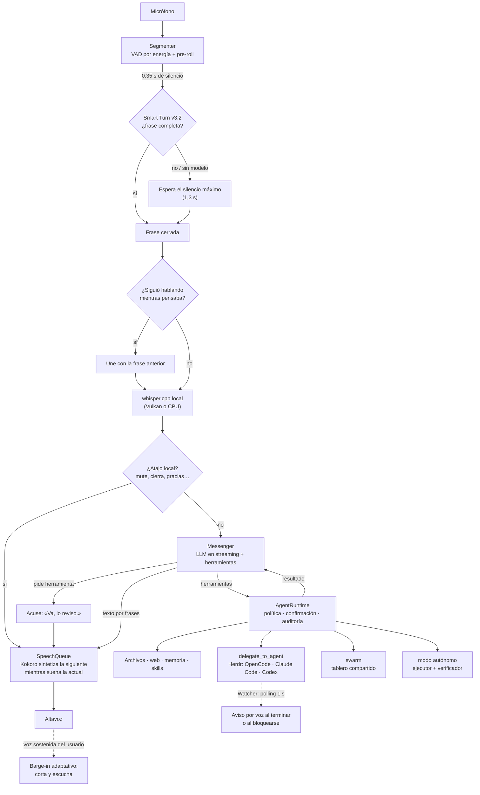
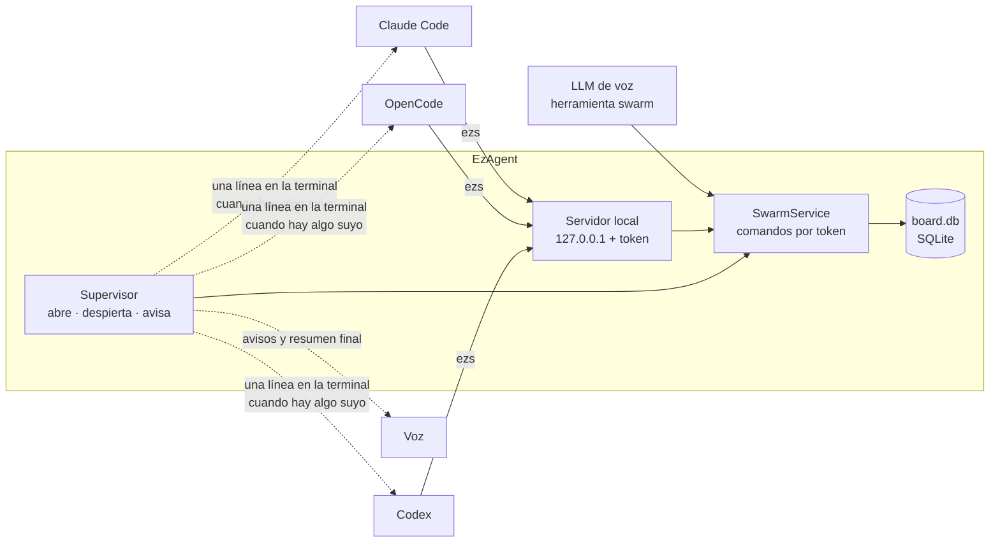

# Arquitectura de EzAgent (Rust)

EzAgent es una capa de voz local para agentes de código. Este documento sigue
un turno de conversación de punta a punta y explica qué crate hace cada parte,
en qué hilo corre, dónde guarda su estado y qué reglas de cerrojos mantienen la
interfaz fluida.

La versión Rust es un solo proceso, `ezagent-voice.exe`, con el bucle de
interfaz en el hilo principal y el resto en hilos con nombre. No hay async ni
tokio: la red usa `reqwest::blocking` en hilos de trabajo y la comunicación
entre hilos va por canales (`crossbeam-channel`) o por estado atómico.

## Vista general



| Etapa | Crate y módulo | Dónde corre |
|---|---|---|
| Captura y VAD | `ez-audio::capture` (`MicCapture`) y `ez-audio::segmenter` | Hilo `ezagent-call` |
| Fin de turno | `ez-audio::turn` (`SmartTurn`, ONNX) | Hilo `ezagent-turn` |
| Transcripción | `ez-stt::client` → `whisper-server` local (`ez-stt::server`) | Hilo `ezagent-stt` por frase |
| Atajos locales | `ez-app::fast` | Hilo principal |
| LLM y herramientas | `ez-llm::messenger` + `ez-agent::runtime` | Hilo `ezagent-turn` y `ezagent-answer` |
| Clientes LLM | `ez-llm::openai`, `ez-llm::anthropic`, `ez-llm::sse` | Hilo del turno |
| Voz | `ez-tts::queue` + `ez-tts::speaker` (Kokoro ONNX) | `ezagent-speech-synth` y `ezagent-speech` |
| Agentes delegados | `ez-herdr::{herdr, driver, session, watcher, tasks}` | Hilos del turno, del vigilante y `ezagent-swarm-*` |
| Avisos | `ez-herdr::watcher`, `ez-herdr::tasks` | `ez-watch-poll` y `ez-watch-events` |
| Modo autónomo | `ez-agent::autonomous` + `ez-app::autonomous` | Hilo `ezagent-autonomo` |
| Interfaz | `ez-hud::win` y `ez-hud::paint` (Win32 layered, barra, tarjeta, vista rápida, Ajustes, chat) | Hilos de pintura del HUD y principal |
| Chat escrito | `ez-chat` (modelo, historial, Markdown, medios) | Hilo del turno, igual que la voz |

## Un turno, paso a paso

### 1. Escuchar y decidir cuándo terminaste

`MicCapture::stream` lee bloques de 30 ms a la frecuencia del micrófono y se los
pasa al `Segmenter`:

- **Arranque:** tres bloques seguidos por encima del umbral, con suelo de ruido
  adaptativo. Se conservan 0,6 s de pre-roll para no perder la primera sílaba.
- **Fin de turno:** con histéresis, solo cuenta como silencio lo que baja del
  umbral de cierre. Tras `turn_quick_secs` (0,35 s) de silencio, el segmentador
  pide a **Smart Turn** si la frase está completa. La inferencia corre en el
  hilo `ezagent-turn` y el hilo de audio no se bloquea: mira el resultado en los
  bloques siguientes.
  - Completa: el turno se cierra ya.
  - Incompleta, o sin modelo: se espera `silence_secs` (1,3 s).
- Smart Turn usa los últimos 8 s a 16 kHz, rellenados con ceros al principio, y
  las características log-mel de Whisper calculadas con `ndarray`.

**Unión de frases.** Si el turno se cerró en una pausa y vuelves a hablar en los
3 s siguientes, mientras EzAgent aún piensa, la respuesta pendiente se descarta
y la frase nueva se transcribe junto con la anterior.

**Barge-in.** `ez-audio::barge_in` compara cada bloque del micrófono con la
referencia de lo que el altavoz está reproduciendo. El umbral es adaptativo
(`máx(piso de ruido × margen, acople × referencia × margen, mínimo)`); el acople
se estima al principio de cada frase, cuando casi seguro solo hay eco. Un clic o
un soplido no cortan; tu voz sostenida sí. La primera frase de una sesión es más
conservadora mientras aprende el acople.

### 2. Transcribir

`ez-stt::server` arranca `whisper-server` en un puerto local libre si no
responde, elige Vulkan o CPU según `stt_engine` y lo precalienta. La frase viaja
como WAV por HTTP local; `ez-stt::client` aplica el diccionario, el tiempo máximo
y el filtro de alucinaciones. El proceso de whisper es hijo de la app y se
detiene al cerrar.

### 3. Atajos locales

Antes del LLM, `ez-app::fast` resuelve órdenes de control sin red: silenciar o
reactivar el micrófono, cerrar la escucha, colgar, repetir, saludar, listar
agentes o tareas y agradecer. Primero quita las cortesías iniciales, así «Ok,
gracias. Mutéate» silencia igual que «mutéate». Estos atajos no pasan por el
modelo ni por la política.

### 4. Pensar: `Messenger` y el núcleo agéntico

`Messenger::ask_stream` abre un hilo por turno y entrega los fragmentos por un
canal. En cada turno:

1. `AgentRuntime::begin_turn` revisa permisos y skills; solo reconstruye las
   herramientas si cambió `permissions.toml` o el catálogo de skills.
2. **Prompt estable**, pensado para la caché por prefijo del proveedor:
   preámbulo de seguridad (inmutable) → `system.md` → guía de acuse → guía de
   ejecución → catálogo de agentes → catálogo de skills. La memoria, las tareas
   pendientes, las ventanas de Herdr y la hora van aparte, al final del turno
   del usuario, etiquetadas como datos.
3. **Herramientas:** 5 de uso real como base y el resto se suman por intención
   (`select_tool_names`), hasta 14. Una consulta de hora no quita `fetch_page`,
   y una skill cargada sigue disponible en el seguimiento. Las herramientas del
   modo autónomo solo se ofrecen si el usuario las autorizó.
4. **Bucle de herramientas:** hasta `llm_max_tool_rounds` rondas (8 por defecto)
   más una ronda final de cierre sin herramientas. Si el modelo pide
   herramientas, el runtime las ejecuta con política, confirmación y auditoría,
   y el resultado vuelve al modelo como mensaje `tool`. Aparte de las rondas, el
   runtime limita las llamadas por turno (`max_tool_calls_per_turn`,
   `permissions.toml`).

**Acuse inmediato.** Si el modelo va a usar una herramienta, el prompt le pide
empezar con una frase corta («Va, lo reviso.»). Si no lo hace, en cuanto llega
la primera llamada a herramienta el código dice un acuse corto según la
herramienta («Busco en la web.», «Le escribo al agente.»). En el chat escrito no
se añaden acuses hablados.

**Clientes.** Según `llm_api_style`, `ez-llm::openai` habla Chat Completions y
`ez-llm::anthropic` traduce a la API Messages (system, `tool_use`,
`tool_result`, SSE) y devuelve trozos con la misma forma, así el bucle de
herramientas no cambia. `friendly_llm_error` convierte 401/403, 404, 413, 429 y
los fallos de conexión en una frase que se dice por voz; el detalle técnico
queda en el log.

### 5. Hablar

`ez-app::workers` consume el streaming y lo corta en frases
(`ez-app::sentences`); el primer trozo es una cláusula corta para que el primer
audio llegue antes. Cada frase se sintetiza con Kokoro en
`ezagent-speech-synth` y se encola; `ezagent-speech` la reproduce. Mientras suena
la frase N, ya se sintetiza la N+1. La síntesis tiene su cerrojo porque Kokoro no
admite dos a la vez, y la reproducción tiene el suyo.

### 6. Medir

`ez-core::metrics::TurnTimings` registra cada turno (con lock corto, porque lo
escriben varios hilos): VAD, STT, primer token del LLM, primera frase, síntesis,
primer audio y duración total. Cada diez turnos añade media y P95 por etapa; todo
queda en `%APPDATA%\EzAgent\logs\latency.jsonl`. Las cifras dependen del equipo,
del modelo y del proveedor; no son garantías.

## Agentes delegados

`ez-agent::tools_herdr` es la única puerta hacia los CLIs de agentes; por debajo,
`ez-herdr` habla con `hc`/`herdr-app`:

- **run:** `ez-herdr::driver` arma el comando desde el perfil de `voice.json`
  (`agents`, `agent_profiles`), con modelo y esfuerzo validados.
  `ez-herdr::session` abre una pestaña visible, espera a que el programa
  arranque, fija modelo y esfuerzo con sus comandos internos y pega la tarea.
  Para tareas de interfaz gráfica (`gui=true`) antepone la guía de cua-driver.
- **send:** envía la tarea a un agente ya abierto tal cual, sin preámbulo.
- **read / get / list / focus / watch / kill:** leer la pantalla, consultar,
  enfocar, vigilar o cerrar.
- **Cadenas** (`input_from`, `then`): cuando un agente termina, su salida pasa
  al siguiente como dato. `handoff` extrae solo la respuesta de la pantalla y
  `handoff_packet` decide si pasa la respuesta corta, la conclusión o un índice
  más el archivo con el registro completo.

**Nombres dictados.** `ez-herdr::herdr::names` normaliza el nombre y lo compara
con los espacios, terminales y agentes vivos (Damerau-Levenshtein, prefijo,
contenido y una clave fonética para nombres ingleses dichos en español). Una
coincidencia exacta se usa; una muy probable se usa y se anota; una dudosa se
pregunta con `ConfirmationManager` («¿Te refieres al espacio «TEST»?»).

**Avisos.** `Watcher` consulta `hc ls --json` cada segundo (`ez-watch-poll`) y
entrega los cambios por `ez-watch-events`. Cuando un agente vigilado termina o
se bloquea, la app avisa por voz con la tarea concreta, guardada en
`tasks.json`. La salida del agente se trata siempre como dato no confiable. Toda
tarea delegada se vigila por defecto (`notify_on_done=false` lo evita). En una
cadena, cada cambio de etapa se dice sin reabrir la escucha y el final nombra
todo el flujo y pregunta qué hacer con el resultado.

**Actividad de la barra.** `ez-app::activity` une lo vivo (terminales vigiladas,
etapas de cadena en espera y enjambres activos) con los desenlaces recientes de
`ActivityLog` (terminó, te necesita, falló, se perdió). Armar la foto no llama a
Herdr. La barra la dibuja como una órbita de marcas por estado y, al dejar el
puntero sobre la forma, como una tarjeta compacta. Hablar o escribir da los
desenlaces por vistos. Cada ventana layered registra sus tiempos de cuadro cada
60 s (`ez-hud::win::frame_stats`).

## Modo enjambre

`ez-swarm` monta un tablero SQLite compartido y un servidor local al que los
agentes hablan con `ezs`:



- **Publicar y suscribirse.** Un agente publica con `ezs done`, `ezs say` o
  `ezs fix`. Su «suscripción» es su rol: el tablero solo le entrega lo que es de
  su rol o está a su nombre y ya tiene las dependencias hechas. Como un CLI no
  puede dejar una conexión abierta, el **supervisor** hace de canal: cuando el
  agente está libre y hay algo suyo, le escribe una línea en la terminal.
- **Contexto bajo demanda.** Al abrir un agente solo se escribe una línea. Su
  papel y las reglas llegan con el primer `ezs next`, y `ezs me` las repite.
- **Roles libres.** Plan, arch, lead, dev, back, front, ux, data, ops, docs, qa,
  test y sec traen tarea y reglas propias; cualquier otro nombre corto vale con
  reglas genéricas y la tarea que diga el usuario. Cada miembro abre una etapa
  que espera a la anterior, salvo los marcados `parallel`.
- **Mensajes de 280 caracteres**; el detalle va en un archivo (`--ref`).
- **Identidad.** Cada miembro tiene un token propio en un archivo de asiento; la
  terminal solo ve su ruta (`EZS_SEAT`). El tablero guarda el resumen del token,
  nunca el token. El servidor solo escucha en `127.0.0.1` y exige token.
- **Incidentes y recuperación** (`ez-swarm::{incidents, recovery}`): cuota
  agotada, contexto lleno, ventana cerrada, programa que sale solo o sesión
  perdida. Las decisiones llegan por voz (`wait`, `replace`, `reopen`, `release`,
  `pause`) y todo sobrevive a un reinicio en `board.db`.
- **Avance por voz** (`ez-swarm::progress`) y **salud por reglas**
  (`ez-swarm::view`), que dice cada aviso una vez.

## Modo autónomo

`ez-agent::autonomous` contiene las piezas puras (estado, artefactos, veredicto,
textos y herramientas con sus guardas); `ez-app::autonomous` contiene el motor
que observa, aprueba, verifica y corrige en el hilo `ezagent-autonomo`:

1. El usuario autoriza con una frase explícita («modo autónomo», «autorizo»,
   «yolo», «sin pedirme permiso» o «sin preguntarme») en sus últimos tres
   mensajes de los últimos 10 minutos. Una negación anula la autorización.
2. La herramienta comprueba que el turno no leyó datos no confiables (`taint`),
   que no hay otra tarea activa y que la carpeta de trabajo existe.
3. Se pide una única confirmación generada por el código, con criterios y
   comprobaciones, carpeta, agente o papeles y topes.
4. El ejecutor trabaja en una terminal visible; el bucle sondea cada segundo las
   direcciones de su alcance. Los permisos de ejecución o edición se aprueban
   como una transacción (leer, esperar 1,5 s, releer, comprobar la generación,
   enviar la opción «una vez» y comprobar que el diálogo desapareció). La lista
   de denegación vive en `ez-herdr::permission`.
5. Al terminar el ejecutor, un verificador nuevo recibe solo el encargo, los
   criterios y su carpeta. Escribe un veredicto con token; dos verificaciones
   limpias seguidas dan la tarea por cumplida.
6. Si no cumple, se escribe `correccion-N.md` con los hallazgos (datos, no
   órdenes) y se manda al ejecutor. Churn, topes, incidentes o un diálogo
   desconocido pausan y preguntan.
7. Los artefactos viven en `%APPDATA%\EzAgent\autonomo\<id>\`: `compartido\`
   (encargo, criterios, correcciones), `verificacion-K\` y `privado\` (estado,
   bitácora, veredictos y resumen). Al arrancar, una tarea a medias vuelve en
   pausa; nunca se reanuda sola.

Las decisiones del bucle son deterministas y están en el diseño
[`docs/designs/modo-autonomo-elefante-pez-dorado.md`](designs/modo-autonomo-elefante-pez-dorado.md);
el modelo solo redacta el encargo y los criterios al empezar, que la persona
confirma.

## Chat escrito

`ez-chat` es independiente del HUD: guarda el historial
(`%APPDATA%\EzAgent\history\chat.jsonl`), mantiene el modelo de la conversación,
parsea Markdown y valida las imágenes y documentos locales antes de mostrarlos.
`ez-app::chat` inyecta ese modelo en el panel del HUD (`ez-hud::win::chat`) y
envía cada mensaje por el mismo `Messenger` que la voz, con `AskMode::Chat` para
permitir Markdown y respuestas largas. El panel se dibuja en su hilo
(`ezagent-chat-paint`), nace de la forma de la barra con una animación y se
cierra con su botón o `Ctrl+Alt+T`.

## Hilos y estado compartido

| Hilo | Qué hace | Cómo se comunica |
|---|---|---|
| Principal (bucle Win32) | Eventos, estados, atajos locales y temporizadores | Cola `events` y `UiLoop::post/schedule` |
| `ezagent-call` | Captura del micrófono, VAD y barge-in | Callbacks → `events` |
| `ezagent-turn` (Smart Turn) | Inferencia de fin de turno | Resultado leído en bloques posteriores |
| `ezagent-turn` (LLM) | Un turno del LLM y sus herramientas | Canal del `AskStream` |
| `ezagent-answer` | Consume el streaming, corta frases y encola voz | `SpeechQueue` y `events` |
| `ezagent-stt` | Transcripción de una frase | `events` |
| `ezagent-speech-synth` | Síntesis de Kokoro | Cola interna |
| `ezagent-speech` | Reproducción | Cola interna |
| `ezagent-models` | Lista de modelos de la API | `events` + `set_llm_models` (con lock) |
| `ezagent-wake` | Comprueba la frase de reactivación | `events` |
| `ez-watch-poll` / `ez-watch-events` | Polling de Herdr y entrega de avisos | Callbacks → `events` |
| `ezagent-autonomo` | Bucle del modo autónomo | `events`, puerto de Herdr y bitácora |
| `ezagent-swarm` / `ezagent-swarm-sup` | Servidor del tablero y supervisor | Servicio y `ezs` |
| `ezagent-tray` | Icono y menú de la bandeja | Callback de la app |
| `ezagent-drop-paint`, `ezagent-card-paint`, `ezagent-peek-paint`, `ezagent-chat-paint` | Pintura de cada ventana layered | Estado modelo con locks cortos |
| `ezagent-config-save` | Guarda `voice.json` fuera del hilo de pintura | Cola de escrituras |
| `ezagent-card-stop`, `ezagent-chat-stop`, `ezagent-autonomo-stop` | Paradas diferidas que no deben esperar dentro de un lock | Un hilo por cierre |

Regla del repositorio: nada bloquea el hilo de UI ni los de audio, y el estado
compartido va con lock o con colas. Los detalles que se aprendieron a golpes:

- **Ningún lock se retiene durante una operación larga, una llamada a otro
  componente ni una operación de ventana.** Se copia el estado con el lock
  tomado, se suelta y después se llama a Herdr, a la barra, al gestor de
  confirmaciones o a Win32. Ya hubo interbloqueos al mover la tarjeta, al cerrar
  el menú, al abrir el chat y al mover la vista rápida.
- **`parking_lot` no es reentrante.** Una función que ya tiene el lock no puede
  volver a pedirlo en el mismo hilo; `advance` de la vista rápida lo hacía.
- **Las paradas que esperan a otro hilo no se hacen con el lock tomado.** La
  tarjeta, el chat y el modo autónomo se paran en hilos propios
  (`ezagent-*-stop`).
- **El lock del micrófono no envuelve la captura.** `MicCapture` es un `Arc` por
  dentro: el menú y el chat leen y escriben ajustes en vivo mientras la captura
  sigue; si el lock cubriera la llamada, el menú no abriría durante una llamada.
- **La referencia de reproducción no usa locks.** Son 32 `AtomicU64` con marca
  de tiempo y nivel cuantizado; el hilo de audio la lee sin poder bloquearse.
- **Las operaciones de ventana se hacen fuera de los locks del modelo.** La
  tarjeta se coloca después de soltar su lock; `tick` de la vista rápida se llama
  después de soltar el de la barra; el panel del chat clona su `Arc` antes de
  `set_keyboard_enabled`/`wake`.
- **Excepción conocida:** guardar `voice.json` desde el hilo de pintura
  (`HudConfig::save`) mantiene el lock de configuración mientras escribe. Es un
  retardo, no un interbloqueo, y está anotado para una tarea de rendimiento.

## Archivos

```
%LOCALAPPDATA%\EzAgent\            binarios y modelos (verificados por SHA256)
  whisper\                         whisper-server (CPU o Vulkan) y modelos
  models\kokoro\                   Kokoro v1.0 int8 y voces
  models\smart-turn-v3.2-cpu.onnx  Smart Turn (8 MB)
%APPDATA%\EzAgent\
  voice.json        ajustes de la app (sin claves)
  llm.json          perfiles de proveedor (con claves; ignorado por git)
  permissions.toml  política
  system.md         comportamiento editable
  tasks.json        tareas vigiladas
  history\chat.jsonl historial del chat
  memory\           USER.md, MEMORY.md, history.db
  swarm\            board.db, endpoint.json, asientos y traspasos
  autonomo\         encargos, criterios, veredictos y resumen por tarea
  logs\             engine.log, audit.jsonl, latency.jsonl
```

## Mapa de crates

| Crate | Qué contiene |
|---|---|
| `ez-core` | Base compartida: `config` (`voice.json`), `agent_config` y `permissions`, `dirs`/`paths`, `downloads`, `llm_providers`, `redact`, `speech_text`, `metrics`, `logging`, `models` y las utilidades de fidelidad con Python (`pyjson`, `pyloads`, `pyvalue`, `pytime`). |
| `ez-gfx` | Ráster y composición del HUD: `Image` RGBA8, `alpha_composite`, `paste`, gradientes, remuestreo, desenfoque, SDF, iconos, dibujo y texto FreeType. |
| `ez-audio` | Captura con cpal, `Segmenter` (VAD por energía y pre-roll), `BargeInDetector` y detector adaptativo, frase de reactivación, remuestreo y `SmartTurn` (ONNX). |
| `ez-stt` | Cliente de `whisper-server`, arranque y parada del servidor, puerto libre, diccionario, filtro de alucinaciones y `casefold`. |
| `ez-tts` | Fonemas de espeak-ng, inferencia Kokoro (ONNX), voces y estilos, cola de frases y `Speaker` (cpal) con la referencia de reproducción. |
| `ez-llm` | Clientes OpenAI y Anthropic, SSE, `Messenger` (bucle de herramientas en streaming), recorte de contexto, condensador, errores amigables y parser de llamadas a herramientas. |
| `ez-agent` | Núcleo agéntico: `registry`, `policy`, `runtime`, `confirm`, `audit`, `journal`, memoria, skills, `handoff`, búsqueda, herramientas (`tools_fs`, `tools_web`, `tools_memory`, `tools_skills`, `tools_herdr`, `tools_swarm`, `tools_d`) y `autonomous`. |
| `ez-herdr` | Adaptador de Herdr: `herdr` (hc, espacios, terminales, nombres), `driver`, `session`, `prelaunch`, `watcher`, `tasks`, `activity` y `permission` (diálogos de permiso y lista de denegación). |
| `ez-swarm` | Modo enjambre: `store`/`db` (SQLite), `service`, `server` (127.0.0.1 con token), cliente `ezs`, `supervisor`, `stack`, `protocol`, `view`, `progress`, `incidents` y `recovery`. |
| `ez-chat` | Chat escrito: `store` (JSONL), `session` (modelo y contextos), `markdown`, `media` (imágenes y documentos), `text_input`, `speech` y `trace`. |
| `ez-hud` | Interfaz: `win` (ventanas layered Win32, bucle de UI, DPI, monitor, teclado, puntero, arrastre, rueda), `paint` (barra, tarjeta, vista rápida, Ajustes, chat, iconos), `model` (estado, geometría, menú, ajustes) y `theme`/`tokens`/`motion`/`pacing`/`layout`. |
| `ez-app` | Orquestación: `app::{core, startup, events, call, states, workers, chat, chat_wiring, watch, settings_apply, menu_wiring, tray_wiring, pause, activity, autonomous, demo, eval, main}`, `fast`, `sentences`, `hotkeys`, `tray` y el arnés `replay` (feature `replay`). Es el crate del binario `ezagent-voice`. |
| `ez-parity` | Utilidades de prueba: carga de fixtures, comparación de trazas e imágenes. Solo se usa en pruebas. |
| `ez-fakes` | Servicios falsos para pruebas y reproducción: `fake_llm`, `fake_whisper`, `fake_hc` y `fake_agent`. |

## Paridad y pruebas

`parity/` guarda el oráculo de Python: fixtures por dominio (`parity/fixtures`),
trazas doradas de los 25 escenarios (`parity/replay`), umbrales de imagen y el
mapa de pruebas. Las pruebas de integración de cada crate consumen esos
fixtures; el arnés `ezagent-replay` arranca el `VoiceApp` real sin ventana ni
hardware, con micrófono de WAV/silencio, altavoz que anota y los servicios falsos
de `ez-fakes`, y compara la traza con la dorada. `parity/regen.ps1 -Check`
comprueba que el oráculo no cambió; `rust/gate.ps1` es la puerta de una tarea.
